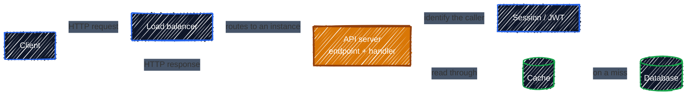
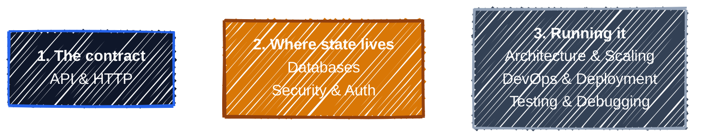

# Python Backend Interview Questions

> A focused set of 41 high-frequency backend interview questions, answered bilingually and from the mechanism up.


Backend interview questions are easy to answer badly. Most have a one-line answer that sounds right and reveals nothing, and the interviewer is listening for the layer underneath: what the protocol actually guarantees, where the state really lives, and what breaks first under load.

This repository is not a backend tutorial and not a framework reference. It is a set of questions selected for backend-engineering interviews, with Python as the assumed language: the concurrency, data-structure, and tooling answers are Python-specific, and everything else - HTTP, databases, security, scaling - transfers to any backend stack. Each question carries a plain-language definition, a short speaking outline, and a complete spoken answer for follow-up, every paragraph in English and Traditional Chinese, because the interview may be in either.

## Why This Guide

Most material teaches the framework. Interviews test the model underneath it: why HTTP being stateless forces a design decision, why a prepared statement stops injection when escaping does not, why the database is the bottleneck before the application is.

That gap is why an engineer who ships APIs daily can still stall on "why does the browser send that cookie at all?" - the daily work never required the answer.

The list is deliberately not senior-only. Interviews open with fundamentals - what an endpoint is, what REST means, SQL versus NoSQL - and those are asked at every level, so they are the highest-frequency questions that exist. A senior candidate is expected to answer them crisply and then go one layer deeper than a junior would.

## If You Are New to Backend Work

The answers are written so you can start anywhere, and two things make that work:

- Every question opens with **In One Sentence** - a plain-language answer with no jargon, before any interview framing.
- Terms carry a link to the [glossary](docs/_glossary.md) the first time a question uses one it does not itself explain, so you never have to have read something else first.

### The Request Mental Model

Almost every question in this repository is about one of the arrows below. The rest of the guide explains what each one really does.



> **In plain language:** a request arrives, gets routed to one of many identical servers, proves who it is, reads data through a cache, and gets an answer back.

### A Beginner's Learning Order

Interview frequency and learning order are not the same. If backend work is new to you, follow the topics in this order, then use the links below to open a section.



> **In plain language:** learn the conversation first, then where the data and the identity are kept, then how to keep the whole thing standing up.

**Open a topic:**

| | | |
|---|---|---|
| **1.** [API & HTTP](docs/api-and-http/) · 9 questions | **2.** [API Design & Reliability](docs/api-design/) · 3 questions | **3.** [Databases](docs/databases/) · 10 questions |
| **4.** [Security & Auth](docs/security-and-auth/) · 7 questions | **5.** [Architecture & Scaling](docs/architecture-and-scaling/) · 7 questions | **6.** [DevOps & Deployment](docs/devops-and-deployment/) · 3 questions |
| **7.** [Testing & Debugging](docs/testing-and-debugging/) · 2 questions |  |  |

## What Each Question Covers

Each question file follows the same structure:

1. **In One Sentence** - the plain-language answer, for when you are meeting the topic for the first time.
2. **Answer Shape** - a short speaking order that moves from the direct answer to an example and a practical consequence.
3. **Full Spoken Answer** - the complete follow-up answer and a bank of details to select from, not a script to deliver in full.
4. **Quick Reference** - on some questions only: the comparison table or code sample worth revising from, kept out of the spoken sections because a table is not something you say out loud.
5. **Previous / Home / Next** - navigation through the interview-priority reading order.

### Which Layer to Answer With

The three sections are the same answer at increasing depth, so you can match the room. The Full Spoken Answer is deliberately longer than a good opening: select the relevant paragraphs when the interviewer follows up instead of reciting all of it.

| Layer | Reach for it when | Spoken length |
|---|---|---|
| **In One Sentence** | They only want to know whether you know the concept at all | about 8 seconds |
| **Answer Shape** | Your default opening. Follow the short speaking order, then stop | 30-50 seconds |
| **Full Spoken Answer** | They followed up, or clearly want the detail | select relevant detail; do not recite all of it |

The order is the point: lead with the answer, stop, and let the interviewer pull you deeper. A correct one-liner followed by silence beats a rambling explanation that never lands the answer.

### High-Frequency Shortcuts

Some interviewers combine several concepts into one question. These common wordings are already covered:

- **"How do you handle authentication?"** start with [Q21](docs/security-and-auth/q21-session-vs-jwt-authentication.md) for the trade-off, then use [Q24](docs/security-and-auth/q24-session-management.md) for the lifecycle and [Q22](docs/security-and-auth/q22-session-vs-cookie.md) if they ask what the cookie is actually carrying.
- **"What happens when I type a URL and hit enter?"** follow the request through [Q02](docs/api-and-http/q02-http-request-response-cycle.md), add routing from [Q03](docs/api-and-http/q03-what-is-an-api-endpoint.md), identity from [Q21](docs/security-and-auth/q21-session-vs-jwt-authentication.md), and the instance fan-out from [Q31](docs/architecture-and-scaling/q31-scaling-during-traffic-surge.md).
- **"Why is this endpoint slow?"** the most common follow-up in the whole set. Start with indexes and the query plan in [Q16](docs/databases/q16-indexes-and-slow-queries.md), rule out an [N+1](docs/databases/q18-n-plus-one-queries.md), then reach for caching in [Q19](docs/databases/q19-caching-strategy-and-invalidation.md) - and use the diagnostic method in [Q52](docs/testing-and-debugging/q52-debugging-a-backend-application.md) to decide which of the three it is.
- **"What happens if the client retries?"** [Q63](docs/api-design/q63-idempotency-and-retries.md) is the direct answer, and it is the same property a queue consumer needs in [Q35](docs/architecture-and-scaling/q35-message-queues-and-async-work.md).
- **"XSS or CSRF?"** they are frequently asked back to back and confused: [Q25](docs/security-and-auth/q25-xss.md) is about your output, [Q26](docs/security-and-auth/q26-csrf.md) is about the browser's credentials.

## The 41 Questions

Ordered by importance, highest first. Read top to bottom and you cover the questions that actually decide interviews before the ones that rarely come up.

Within a band the order is by question number and means nothing - the bands are the claim, not the sequence inside them. Most questions land in the middle two bands, which is what an honest frequency estimate looks like rather than a problem to spread out.

**Importance** is a 1-10 estimate of how often the question is asked, across junior and senior interviews alike. Frequency is the dominant factor - a fundamental that opens almost every interview scores higher than a subtle question that impresses when it appears but usually does not. It is not a difficulty rating.

### Importance 10/10 (5 questions)

| Question | Part | Focus | Status |
|---|---|---|---|
| [What is a RESTful API, and what are its core principles?](docs/api-and-http/q01-what-is-a-restful-api.md) | API & HTTP | The six constraints, and which ones actually change your design | Draft |
| [Can you describe a typical HTTP request/response cycle?](docs/api-and-http/q02-http-request-response-cycle.md) | API & HTTP | Connection, request, processing, response, and connection reuse | Draft |
| [Can you explain the difference between SQL and NoSQL databases?](docs/databases/q11-sql-vs-nosql.md) | Databases | Relational schema and ACID vs flexible models and horizontal scale | Draft |
| [What is a database index, and how do you work out why a query is slow?](docs/databases/q16-indexes-and-slow-queries.md) | Databases | B-tree lookup, what an index costs, and reading a query plan | Draft |
| [What is the difference between session-based and JWT-based authentication?](docs/security-and-auth/q21-session-vs-jwt-authentication.md) | Security & Auth | Server-side state vs a signed self-contained token | Draft |

### Importance 9/10 (7 questions)

| Question | Part | Focus | Status |
|---|---|---|---|
| [Explain statelessness in HTTP and how it impacts backend services.](docs/api-and-http/q04-http-statelessness.md) | API & HTTP | Independent requests, and where the state has to go instead | Draft |
| [What measures would you take to secure a newly developed API?](docs/api-and-http/q07-securing-a-new-api.md) | API & HTTP | Identity, permission, input, protection, monitoring - as five layers | Draft |
| [Explain database transactions and isolation levels.](docs/databases/q17-transactions-and-isolation-levels.md) | Databases | ACID in practice, the four levels, and the anomalies each prevents | Draft |
| [What is the N+1 query problem, and how do you fix it?](docs/databases/q18-n-plus-one-queries.md) | Databases | One query per row, why an ORM hides it, and eager loading | Draft |
| [How do you protect a server from SQL injection attacks?](docs/security-and-auth/q23-sql-injection.md) | Security & Auth | Parameterized queries, ORMs, and defense in depth | Draft |
| [How would you scale a backend application during a traffic surge?](docs/architecture-and-scaling/q31-scaling-during-traffic-surge.md) | Architecture & Scaling | Horizontal scaling, statelessness, caching, and shedding load | Draft |
| [Discuss multiprocessing, multithreading, and asynchronous I/O in Python.](docs/architecture-and-scaling/q32-python-concurrency-models.md) | Architecture & Scaling | The GIL, and matching the model to I/O-bound or CPU-bound work | Draft |

### Importance 8/10 (17 questions)

| Question | Part | Focus | Status |
|---|---|---|---|
| [What is an API endpoint?](docs/api-and-http/q03-what-is-an-api-endpoint.md) | API & HTTP | A URL as the entry point to one resource or capability | Draft |
| [What are the benefits and drawbacks of RESTful APIs?](docs/api-and-http/q05-rest-benefits-and-drawbacks.md) | API & HTTP | Scalability and standardization vs over-fetching and versioning cost | Draft |
| [How do you approach API versioning in your projects?](docs/api-and-http/q06-api-versioning.md) | API & HTTP | URL vs header versioning, and when a version is needed at all | Draft |
| [What is the difference between a REST API and a WebSocket?](docs/api-and-http/q08-rest-vs-websocket.md) | API & HTTP | Request-response vs a persistent bidirectional connection | Draft |
| [What is data normalization?](docs/databases/q12-data-normalization.md) | Databases | 1NF to BCNF, the anomalies each form removes, and when to stop | Draft |
| [What is data partitioning?](docs/databases/q13-data-partitioning.md) | Databases | Horizontal, vertical, range, hash, and list partitioning | Draft |
| [What are the common application scenarios for Redis?](docs/databases/q14-redis-use-cases.md) | Databases | Cache, session store, rate limiter, queue, and leaderboard | Draft |
| [How do you decide what to cache, and how do you invalidate it?](docs/databases/q19-caching-strategy-and-invalidation.md) | Databases | Cache-aside vs write-through, TTLs, stampedes, and staleness | Draft |
| [How do you change a database schema without downtime?](docs/databases/q20-schema-migrations.md) | Databases | Expand and contract, backwards-compatible steps, and long locks | Draft |
| [What is the difference between a session and a cookie?](docs/security-and-auth/q22-session-vs-cookie.md) | Security & Auth | Client-side storage vs server-side state, and how they connect | Draft |
| [What is Cross-Site Scripting (XSS)?](docs/security-and-auth/q25-xss.md) | Security & Auth | Injected script running with the trusted site's privileges | Draft |
| [What is CORS?](docs/security-and-auth/q27-cors.md) | Security & Auth | Same-origin policy, preflight, and what CORS does not protect | Draft |
| [Explain the underlying data structures of lists, sets, tuples, and dictionaries in Python.](docs/architecture-and-scaling/q33-python-builtin-data-structures.md) | Architecture & Scaling | Dynamic arrays and hash tables, and the complexity that follows | Draft |
| [Monolith or microservices - how would you decide?](docs/architecture-and-scaling/q36-monolith-vs-microservices.md) | Architecture & Scaling | Deployment coupling, team boundaries, and the costs you inherit | Draft |
| [What is containerization, and how does it benefit backend development?](docs/devops-and-deployment/q41-what-is-containerization.md) | DevOps & Deployment | Packaging the runtime with the app, and the boundary of that promise | Draft |
| [What kind of tests would you write for a new API endpoint?](docs/testing-and-debugging/q51-testing-a-new-api-endpoint.md) | Testing & Debugging | Unit, integration, contract, and load tests, and what each proves | Draft |
| [How do you choose HTTP status codes and design error responses?](docs/api-design/q61-status-codes-and-error-responses.md) | API Design & Reliability | Status classes, and an error body a client can act on | Draft |

### Importance 7/10 (9 questions)

| Question | Part | Focus | Status |
|---|---|---|---|
| [How would you handle file uploads in a web application?](docs/api-and-http/q09-file-uploads.md) | API & HTTP | Validation, naming, metadata, and keeping bytes out of the app server | Draft |
| [Describe how session management works in web applications.](docs/security-and-auth/q24-session-management.md) | Security & Auth | Session lifecycle, storage, and scaling it across servers | Draft |
| [What is Cross-Site Request Forgery (CSRF)?](docs/security-and-auth/q26-csrf.md) | Security & Auth | Riding the victim's ambient credentials, and how tokens stop it | Draft |
| [When would you move work onto a message queue?](docs/architecture-and-scaling/q35-message-queues-and-async-work.md) | Architecture & Scaling | Decoupling, absorbing bursts, and what a queue makes harder | Draft |
| [How do you stop one slow dependency from taking down your service?](docs/architecture-and-scaling/q37-timeouts-retries-and-failure.md) | Architecture & Scaling | Timeouts, bounded retries with backoff, and circuit breakers | Draft |
| [How do you deploy a new version without dropping requests?](docs/devops-and-deployment/q43-zero-downtime-deploys.md) | DevOps & Deployment | Rolling, blue-green, and canary, plus health checks and rollback | Draft |
| [What tools and techniques do you use for debugging a backend application?](docs/testing-and-debugging/q52-debugging-a-backend-application.md) | Testing & Debugging | Reproduce, narrow, then instrument - locally and in production | Draft |
| [How would you paginate a large collection endpoint?](docs/api-design/q62-pagination.md) | API Design & Reliability | Offset vs cursor pagination, and why deep offsets get slow | Draft |
| [How do you make an endpoint safe to retry?](docs/api-design/q63-idempotency-and-retries.md) | API Design & Reliability | Idempotent methods, idempotency keys, and exactly-once delivery | Draft |

### Importance 6/10 (2 questions)

| Question | Part | Focus | Status |
|---|---|---|---|
| [What strategies do you have when a database runs out of storage?](docs/databases/q15-database-out-of-storage.md) | Databases | Immediate relief, then reclaiming, growing, and splitting | Draft |
| [How do you ensure your backend code is maintainable and easy to understand?](docs/architecture-and-scaling/q34-maintainable-backend-code.md) | Architecture & Scaling | Boundaries, conventions, tests, and consistent failure handling | Draft |

### Importance 5/10 (1 question)

| Question | Part | Focus | Status |
|---|---|---|---|
| [What are the benefits of Docker multi-stage builds?](docs/devops-and-deployment/q42-docker-multi-stage-builds.md) | DevOps & Deployment | Separating build toolchain from the runtime image | Draft |


## Progress Model

| Status | Meaning |
|---|---|
| Outline | The question exists and its scope is defined. |
| Draft | The answer has a complete first pass and can be read end to end. |
| Review | The answer is being checked for clarity, correctness, and interview usefulness. |
| Complete | The answer is polished and stable. |

## Who This Is For

- Backend engineers preparing for interviews, in English or in Traditional Chinese.
- Engineers who build APIs daily but have never had to explain them out loud.
- Anyone who can ship a working endpoint but would stall on why it works.
- Interviewers looking for questions that separate familiarity from understanding.

## Prerequisites

Comfort with Python and the shell. You should know what a function, a process, and an environment variable are, and have written enough Python to recognise a decorator and a context manager. SQL is assumed at the level of writing a join. No specific web framework is required; examples use Django and SQLAlchemy where an ORM is unavoidable.

Everything else is explained here or in the [glossary](docs/_glossary.md).

## How to Use This Guide

1. Read the table top to bottom. It is ordered by importance, so if you stop halfway you have still covered the half that matters most.
2. For a systematic pass instead, follow the learning-order map above - the contract first, then where state lives, because the later answers build on both.
3. Jump directly to a question when preparing for a specific topic, or when a real incident sent you here.
4. Practice out loud in the Answer Shape order: direct answer, plain-language explanation, example, practical consequence. Time yourself - a good opening is 30 to 50 seconds before the follow-up.
5. Then close the file and answer again without looking. The goal is natural delivery, not memorized wording.

## Tooling

The README, the glossary, and every navigation footer are generated. Edit the data, not the output:

```bash
python3 tools/build.py    # regenerate stubs, glossary, README, nav footers
python3 tools/check.py    # verify structure, links, numbering, bilingual shape
```

See [tools/README.md](tools/README.md) for what each module owns.
