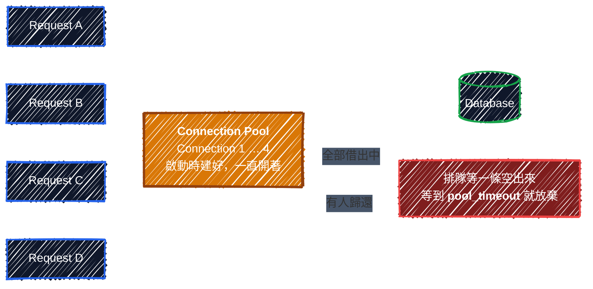

# Q38: What is a database connection pool, and how do you size it?

> Tests whether you know the pool is a limit as much as a reuse mechanism - that the database sets the ceiling, not the application, and that exhausting it looks like a total outage rather than a slow query.

**Part:** Architecture & Scaling | **Importance:** 7/10 | **Status:** Complete

**New to these terms?** [resource](../_glossary.md#resource), [tcp](../_glossary.md#tcp), [tls](../_glossary.md#tls), [schema migration](../_glossary.md#schema-migration), [timeout](../_glossary.md#timeout)

## In One Sentence

Building a database connection is expensive, so the application builds a batch of them up front and lets requests borrow and return them, instead of opening a new one for every query.

建立 DB connection 很貴，所以應用程式預先建立一批放著，讓每個 request 借來用完再還，而不是每個 query 都開一條新的。

## Answer Shape

Start from what happens without a pool, because the cost is the reason it exists. Then say what the pool changes in one line: borrow, use, return, not open and close. Spend most of the answer on sizing, because that is what gets followed up - do the multiplication with real numbers, then say why `max_connections` is not the real ceiling. Finish on how you would actually tune it, since the honest answer is "measure", not a magic number.

從「沒有 pool 會怎樣」開始，因為那個成本就是它存在的理由。然後一句話說清楚 pool 改變了什麼：借、用、還，不是開了又關。答案的重心放在 sizing，因為那才是會被追問的地方 —— 用真實數字算一次乘法，再說明為什麼 `max_connections` 不是真正的上限。最後收在你實際會怎麼調，因為誠實的答案是「看數據」，不是某個神奇的數字。

## Full Spoken Answer

Without a pool, every request opens a connection, runs its query, and closes it. The problem is that opening one is not free. You pay a TCP handshake, a TLS handshake if the connection is encrypted, and an authentication round trip, and then the database allocates resources for it - PostgreSQL forks a process per connection, MySQL spawns a thread. That is several milliseconds of setup for a query that might take one. A connection pool builds a batch of connections up front and keeps them open. A request borrows one, runs its SQL, and returns it to the pool. The key point is that returning is not closing: the connection stays open for the next request, so the setup cost is paid once instead of every time.

沒有 pool 的話，每個 request 都要開一條 connection、跑完 query、再關掉。問題是開一條並不免費。你要付 TCP 三次握手、有加密的話還有 TLS 握手，再加一次認證往返，然後 DB 還要為它配資源 —— PostgreSQL 每條 connection fork 一個 process，MySQL 開一條 thread。這是好幾毫秒的準備工作，而那個 query 可能只跑一毫秒。Connection Pool 的做法是預先建好一批 connection 並保持開著。Request 借一條、執行 SQL、再還回 pool。重點是「還」不等於「關」：那條 connection 會留著給下一個 request 用，所以準備成本只付一次，不是每次都付。

Then sizing, which is where the follow-up goes. The number to work out is not the pool size, it is the total, and the multiplication is Pod count times pool size. Five Pods with a pool of twenty is a hundred connections, which is reasonable against a `max_connections` of two hundred. Twenty Pods with a pool of fifty is a thousand, and the database simply cannot take it. And whatever the total is, it has to leave room for the DBA, for migrations, for monitoring, and for any other service on the same database.

接著是 sizing，追問通常就問到這裡。要算的不是 pool size，是總數，而算法是 Pod 數量乘上 pool size。5 個 Pod、每個 pool 20，就是 100 條，對一個 `max_connections` 設 200 的 DB 來說算合理。20 個 Pod、每個 pool 50，那是 1000 條，DB 根本承受不了。而且不管總數是多少，都要留一部分給 DBA、migration、monitoring，以及同一個 DB 上的其他服務。

But `max_connections` is not the real ceiling, and this is the part worth saying out loud because it is the common follow-up. If the limit is two hundred, that does not mean you should hand a hundred and eighty to the application. A database's useful concurrency is bounded by cores and disk, not by the config value. Past that point, more connections means more queries competing for CPU, memory, disk I/O, and locks - so you get more connections and a slower database. The honest way to put it is that a connection pool is not a speed knob. Turning it up does not make the database faster, it just changes where the queue forms: in your application, where you can measure it and time it out, or inside the database, where you can do neither.

但 `max_connections` 不是真正的上限，這一段值得主動講出來，因為它是最常見的追問。DB 上限是 200，不代表你就應該開 180 給 application。DB 能有效處理的並行量取決於 CPU 核心數和磁碟，不是那個設定值。超過之後，connection 愈多只是愈多 query 同時去搶 CPU、記憶體、Disk I/O 和 locks —— 結果是 connection 更多，但 DB 反而更慢。誠實的說法是：connection pool 不是一個調速旋鈕。把它調大不會讓 DB 變快，只是換一個地方排隊 —— 排在你的應用裡，你量得到也設得了 timeout；排在 DB 裡面，這兩件事你都做不到。

So in practice you start from a small pool and tune it from data, not from a formula. The four things to watch are pool utilization, how long a request waits to get a connection, DB CPU, and query latency. They give you a clear rule in both directions. If the pool is always fully checked out and requests are queueing for a connection, but DB CPU is only at thirty percent, the database has room and raising the pool is the right move. If DB CPU is at ninety-five percent and queries are already slow, raising the pool makes it worse - you are just sending more concurrent queries at a database that is already saturated. Then the problem is the queries or the hardware, and the pool is not where to look.

所以實務上是從一個小的 pool 開始，然後看數據調，不是套公式。要觀察的有四項：pool 使用率、request 等 connection 的時間、DB CPU、query latency。它們給你的判斷規則在兩個方向都很明確。如果 pool 常常全被借走、很多 request 在等 connection，但 DB CPU 才 30%，那代表 DB 還有餘力，加大 pool 是對的。如果 DB CPU 已經 95%、query 本來就慢，加大 pool 只會更糟 —— 你只是讓更多 query 同時打進一個已經飽和的 DB。這時問題出在 query 或硬體，不在 pool。

The failure mode worth naming is pool exhaustion, because it is what you get paged for and it is routinely misdiagnosed. When every connection is checked out, the next request does not fail, it waits. If `pool_timeout` is long or unset, the waiting requests pile up until every web worker is doing nothing but holding a place in the queue, and the service stops answering entirely - including endpoints that never touch that table. The symptom looks like a dead service, not a slow query, so people go and debug the wrong layer. It is usually caused by one slow query, or by a connection that was borrowed and never returned because an exception skipped the release. So set a bounded `pool_timeout` and always borrow through a context manager. Two settings also worth knowing: `pool_pre_ping` checks a connection is alive before lending it out, which is what stops a failover turning into a burst of errors, and if you genuinely do have hundreds of Pods, the answer is PgBouncer in front of the database rather than a bigger pool.

要能講出來的故障模式是 pool 耗盡，因為那是你會被 call 起來處理的狀況，而且常常被誤判。當所有 connection 都被借走，下一個 request 不是失敗，是等。如果 `pool_timeout` 設很長或沒設，等待的 request 會愈積愈多，直到每個 web worker 都在排隊什麼事也沒做，服務就完全不回應了 —— 連那些根本不碰這張表的 endpoint 也一樣。症狀看起來像「服務掛了」而不是「query 慢」，所以大家會跑去除錯錯的那一層。原因通常是某個慢 query，或是一條借走沒還的 connection —— 例外把 release 跳過去了。所以要設一個有界的 `pool_timeout`，而且一律用 context manager 借。另外兩個設定值得知道：`pool_pre_ping` 會在借出前確認 connection 還活著，這能讓一次 failover 不變成一串錯誤；而如果你真的有好幾百個 Pod，答案是在 DB 前面放 PgBouncer，不是把 pool 開更大。

## Quick Reference

**Without a pool - setup cost on every request:**


**With a pool - built once, borrowed and returned:**



**The arithmetic:**

```
Pod 數 × pool_size  ≤  DB 給這個應用的 connection budget

  5 Pods × pool_size 20  =   100    ✅ against max_connections 200
 20 Pods × pool_size 50  =  1000    ❌ DB 承受不了
```

**Tuning from metrics:**

| Pool utilization | Connection wait time | DB CPU | What it means | Action |
|---|---|---|---|---|
| Always 100% | Rising | ~30% | The database has room; the pool is the bottleneck | Raise `pool_size` |
| Always 100% | Rising | ~95% | The database is saturated; the pool is protecting it | Fix the queries or scale the DB - not the pool |
| Rarely full | ~0 | Low | Correctly sized | Leave it alone |
| Always 100% | Hits `pool_timeout` | Low | A slow query or a leaked connection is holding them | Find the long checkout, not a bigger pool |

| Setting | What it does | Getting it wrong |
|---|---|---|
| `pool_size` | Connections kept open and reused | Too small: requests queue. Too large: the DB thrashes |
| `max_overflow` | Extra connections at peak, closed afterwards | Counts toward `max_connections` too - include it |
| `pool_timeout` | How long a request waits for a free connection | Unset or long: waiters pile up and the service stalls |
| `pool_recycle` | Retire a connection after this many seconds | Unset: connections killed by a firewall are handed out dead |
| `pool_pre_ping` | Test the connection before lending it out | Off: the first requests after a DB restart fail for no reason |

## Interview Version

> A connection pool lets the application reuse connections it has already built, instead of opening a new one for every request - because opening one costs a TCP handshake, a TLS handshake, and an authentication round trip, and then the database allocates a process or a thread for it. A request borrows a connection, runs its SQL, and returns it to the pool rather than closing it. For sizing, I would not just make the pool large. The number that matters is the total, and that is Pod count times pool size: five Pods with a pool of twenty is a hundred connections, which is fine against a `max_connections` of two hundred, while twenty Pods with a pool of fifty is a thousand and the database cannot take it. And I would leave room for the DBA, migrations, and monitoring. But `max_connections` is not the real ceiling: a database's useful concurrency is bounded by cores and disk, so past that point more connections just means more queries competing for CPU, memory, disk I/O, and locks, and you end up with more connections and a slower database. So in practice I start small and tune from metrics - pool utilization, connection wait time, DB CPU, query latency. If the pool is always full and requests are waiting but DB CPU is only thirty percent, raising it is right. If DB CPU is ninety-five percent and queries are slow, raising it makes things worse. The failure to watch for is exhaustion: when every connection is checked out, requests wait rather than fail, and the whole service stalls - which looks like a dead service, not a slow query.

面試時可回答：Connection Pool 是讓應用程式重複使用已經建立好的 DB connection，而不是每個 request 都重開一條 —— 因為開一條要付 TCP 握手、TLS 握手和一次認證往返，然後 DB 還要為它配一個 process 或 thread。Request 借一條 connection、執行 SQL，再還回 pool，而不是把它關掉。Sizing 的時候我不會單純把 pool 開大。真正要看的是總數，算法是 Pod 數量乘上 pool size：5 個 Pod、每個 pool 20，就是 100 條，對 `max_connections` 設 200 的 DB 來說沒問題；20 個 Pod、每個 pool 50 就是 1000 條，DB 承受不了。而且要留一部分 connection 給 DBA、migration 和 monitoring。但 `max_connections` 不是真正的上限：DB 能有效處理的並行量取決於 CPU 核心數和磁碟，超過之後，更多 connection 只是更多 query 去搶 CPU、記憶體、Disk I/O 和 locks，結果是 connection 變多、DB 反而更慢。所以實務上我會從小的開始，再看指標調 —— pool 使用率、等 connection 的時間、DB CPU、query latency。如果 pool 常常滿、request 在等，但 DB CPU 才 30%，那加大是對的。如果 DB CPU 已經 95%、query 也慢，加大只會更糟。要留意的故障是 pool 耗盡：所有 connection 都被借走時，request 是等而不是失敗，整個服務就卡住 —— 那看起來像服務掛了，不像 query 慢。

The sentence to remember is: **Total connections is Pod count times pool size, but the real ceiling is how many concurrent queries the database can actually handle, not `max_connections`.**

最值得記：**總 connection 數 ≈ Pod 數 × pool size，但真正的上限取決於 DB 能有效處理多少並行 query，而不只是 `max_connections`。**

---

| ⬅ Previous | Home | Next ➡ |
|---|---|---|
| [Q37: How do you stop one slow dependency from taking down your service?](q37-timeouts-retries-and-failure.md) | [All 51 questions](../../README.md) | [Q43: How do you deploy a new version without dropping requests?](../devops-and-deployment/q43-zero-downtime-deploys.md) |
