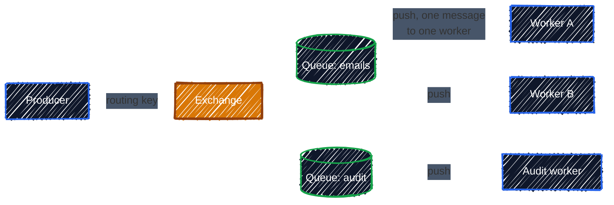
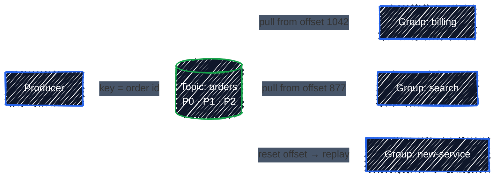

# Q39: What is the difference between Kafka and RabbitMQ, and when would you pick each?

> Tests whether you know the two are built on different models - a queue that hands each message out and forgets it, and a log that keeps every message and lets each reader track its own place - and can pick from the workload instead of from popularity.

**Part:** Architecture & Scaling | **Importance:** 7/10 | **Status:** Complete

**New to these terms?** [idempotent](../_glossary.md#idempotent), [head-of-line blocking](../_glossary.md#head-of-line-blocking), [partitioning](../_glossary.md#partitioning), [at-least-once delivery](../_glossary.md#at-least-once-delivery), [dead-letter queue](../_glossary.md#dead-letter-queue)

## In One Sentence

RabbitMQ is like a post office for jobs - it hands each message to one worker and deletes it once the worker confirms - while Kafka is a log that keeps every message for days and lets each reader hold its own bookmark, so the same message can be read by many consumers and read again later.

RabbitMQ 像一間處理工作的郵局 —— 把每則訊息交給一個 worker，對方確認收到就刪掉；Kafka 則是一本日誌，把每則訊息保留好幾天，讓每個讀者各自夾自己的書籤，所以同一則訊息可以被很多消費者讀，之後也還能再讀一次。

## Answer Shape

Lead with the model, not the feature list: RabbitMQ is a broker that tracks every message and forgets it once acknowledged, Kafka is a log that stores messages and leaves the tracking to the consumer. Replay, fan-out, ordering, and throughput all follow from that one difference, so derive them rather than list them. Then give the deciding question - is this message a job for one worker, or a fact that several readers need - with one example of each. Finish with what each one costs, because reaching for Kafka to run a simple job queue is the common mistake.

先講模型，不要先列功能清單：RabbitMQ 是一個追蹤每則訊息、確認後就忘掉它的中介；Kafka 是一本把訊息存起來、把「讀到哪裡」交給消費者自己記的日誌。重播、扇出、順序、吞吐量全都從這一個差異推得出來，所以用推的，不要用背的。接著給出判斷問題 —— **這則訊息是一份給某個 worker 做的工作，還是一個好幾方都需要知道的事實？** —— 各舉一個例子。最後講兩者各自的代價，因為拿 Kafka 來跑一個單純的工作佇列，是最常見的錯誤。

## Full Spoken Answer

The cleanest way to answer is that they are built on different models, and almost every difference falls out of that. RabbitMQ is a message broker in the classic sense. A producer publishes to an exchange, the exchange routes the message into one or more queues by its routing key, and the broker pushes each message to a consumer and waits for an acknowledgement. Once the consumer acks, the message is deleted. The broker does the bookkeeping: it knows, per message, whether it is waiting, in flight, or done, and if a consumer dies without acking, the broker hands that message to someone else. That is why it is often summed up as a smart broker with simple consumers.

最乾淨的回答方式是：**它們建立在不同的模型上，而幾乎所有差異都是從這裡掉出來的。** RabbitMQ 是傳統意義上的訊息中介。生產者把訊息發布到一個 exchange，exchange 依照 routing key 把訊息路由進一個或多個佇列，然後 broker 把每則訊息推給一個消費者，等它回確認。消費者一 ack，這則訊息就被刪掉。記帳的是 broker：它逐則知道每則訊息是在排隊、處理中、還是已完成；如果某個消費者沒 ack 就掛了，broker 會把那則訊息交給別人。這就是為什麼它常被總結成「**聰明的 broker，單純的消費者**」。

Kafka is a distributed, append-only log. A topic is split into partitions, each partition is an ordered sequence of messages, and every message gets a position in it called an offset. Reading does not remove anything: messages stay until a retention period expires - seven days by default - or, on a compacted topic, until a newer message with the same key replaces them. The broker does not track who has read what message by message; each consumer group simply records the offset it has reached in each partition. So it is the opposite arrangement - a simple broker that stores, and consumers that keep their own place. Within one consumer group, each partition is read by exactly one consumer, which is how Kafka keeps order and also why the partition count is the ceiling on that group's parallelism.

Kafka 是一個分散式、只能往後附加的日誌。一個 topic 被切成好幾個 partition，每個 partition 是一串有順序的訊息，每則訊息在裡面都有一個位置，叫做 offset。**讀取不會移除任何東西**：訊息會一直留著，直到保留期限到期（預設七天），或是在 compacted topic 上，被同一個 key 的較新訊息取代為止。broker 不逐則追蹤誰讀了哪則；每個 consumer group 只是記下自己在每個 partition 讀到了哪個 offset。所以這是反過來的安排 —— **單純負責儲存的 broker，自己記位置的消費者。** 在同一個 consumer group 裡，每個 partition 只會被一個消費者讀，這是 Kafka 維持順序的方式，也是為什麼 **partition 數就是這個 group 平行度的上限**。

Those two models explain the differences people usually list. Replay: in Kafka you can reset a group's offset and reprocess last week's events - to backfill a new service, or to rerun after fixing a bug - while in RabbitMQ an acked message is gone. Fan-out: in Kafka a second team just adds a second consumer group and reads the same topic independently, at no cost to the first; in RabbitMQ you bind another queue to the exchange, and each queue holds its own copy. Ordering: Kafka guarantees order within a partition, so producing with a key such as the order id keeps every event for one order in sequence; a RabbitMQ queue is first-in first-out, but once several competing consumers and redeliveries are involved, processing order is no longer guaranteed. Throughput: because Kafka writes sequentially to disk and consumers pull in batches, it sustains far higher volume than a broker tracking each message individually. In exchange, RabbitMQ gives you what Kafka does not have per message: flexible routing, individual acknowledgement and retry, priorities, per-message expiry, and a dead-letter exchange for messages that keep failing.

這兩種模型就解釋了大家通常會列的那些差異。**重播**：在 Kafka 裡你可以把一個 group 的 offset 調回去，重新處理上週的事件 —— 用來幫新服務補資料，或是修完 bug 之後重跑一次；而在 RabbitMQ 裡，已 ack 的訊息就沒了。**扇出**：在 Kafka 裡，第二個團隊只要加一個新的 consumer group，就能獨立讀同一個 topic，對第一個團隊零成本；在 RabbitMQ 裡則是在 exchange 上再綁一個佇列，每個佇列各自保有一份副本。**順序**：Kafka 保證單一 partition 內的順序，所以用像訂單 id 這樣的 key 來發布，同一張訂單的所有事件就會照順序；RabbitMQ 的佇列本身是先進先出，但一旦有多個競爭的消費者加上重新投遞，處理順序就不再有保證。**吞吐量**：因為 Kafka 是循序寫入磁碟、消費者成批拉取，它能撐住的量遠高於一個逐則追蹤訊息的 broker。作為交換，RabbitMQ 給你 Kafka 在單則訊息層級沒有的東西：彈性路由、逐則確認與重試、優先權、單則訊息的過期時間，以及一個給持續失敗訊息用的 dead-letter exchange。

So the question I actually ask is whether the message is a job or a fact. A job has one thing to do and one worker should do it - send this email, resize this image, generate this report. You want it acknowledged individually, retried if it fails, dead-lettered if it keeps failing, and then forgotten. That is RabbitMQ, and in Python it is usually Celery on top of it. A fact is something that happened - order placed, payment captured, user updated - and several systems care about it: billing, inventory, search, analytics, and possibly a service that does not exist yet. You want it kept, read independently by each of them, and replayable. That is Kafka, and it is also the natural fit for event sourcing, change data capture, and log or metrics pipelines.

所以我真正會問的是：**這則訊息是一份工作，還是一個事實？** 工作只有一件事要做，而且應該由一個 worker 來做 —— 寄這封信、縮這張圖、產生這份報表。你希望它被逐則確認、失敗就重試、一直失敗就進死信、做完就忘掉。這是 RabbitMQ，而在 Python 裡通常就是架在它上面的 Celery。事實則是「已經發生的事」—— 訂單成立、款項入帳、使用者資料更新 —— 而且有好幾個系統在乎它：帳務、庫存、搜尋、分析，甚至一個還不存在的服務。你希望它被保留、被每個系統各自獨立地讀、而且能重播。這是 Kafka，它也是 event sourcing、change data capture，以及日誌或指標管線的自然選擇。

Each has costs worth naming, because choosing Kafka for a plain task queue is the common mistake. Kafka has no per-message acknowledgement - a consumer commits an offset, which means everything before it is done - so one message that keeps failing stalls its whole partition, a form of head-of-line blocking, unless you build a retry topic and a dead-letter topic yourself. Parallelism is capped at the partition count, and adding partitions later changes which partition a key maps to, which breaks per-key ordering across the change. It is also a heavier system to run. RabbitMQ's cost runs the other way: there is no replay, and it is designed for queues that stay short, so a backlog of millions of messages is a sign you have the wrong tool. And for both, delivery is at-least-once in practice - Kafka redelivers anything after the last committed offset, RabbitMQ redelivers anything unacked - so every handler still has to be idempotent. Kafka's exactly-once feature covers reading from and writing back to Kafka, not the email your handler sends.

兩者各有值得點名的代價，因為拿 Kafka 來當單純的任務佇列是最常見的錯誤。**Kafka 沒有逐則確認** —— 消費者提交的是一個 offset，代表「它之前的全部都處理完了」—— 所以一則一直失敗的訊息會卡住它整個 partition，這是一種 head-of-line blocking，除非你自己做一個重試 topic 和死信 topic。平行度的上限是 partition 數，而事後增加 partition 會改變 key 對應到哪個 partition，在切換的那一刻就破壞了同一個 key 的順序。它維運起來也是比較重的系統。RabbitMQ 的代價則是反過來的：**沒有重播**，而且它是為「保持很短的佇列」設計的，所以一份上百萬則的積壓，代表你選錯工具了。而兩者實務上都是**至少一次**交付 —— Kafka 會重送最後一次提交的 offset 之後的所有訊息，RabbitMQ 會重送所有沒被 ack 的訊息 —— 所以每個處理函式仍然必須是冪等的。Kafka 的 exactly-once 功能涵蓋的是「從 Kafka 讀、再寫回 Kafka」，**不包括你的處理函式寄出去的那封信。**

One nuance is worth having ready, because it shows your knowledge is current: the line is blurring from both sides. RabbitMQ now has streams, an append-only log type that supports replay, and recent Kafka versions add share groups, which let several consumers work through the same partition with per-message acknowledgement, much closer to a queue. Neither changes the default answer - you still choose by the model each system was built around, and the newer feature is the exception you reach for, not the reason to pick the tool.

有一個細節值得先準備好，因為它代表你的知識是新的：**這條界線正從兩邊變模糊。** RabbitMQ 現在有 stream，一種支援重播、只能往後附加的日誌型別；而較新的 Kafka 版本加入了 share group，讓多個消費者能以逐則確認的方式一起消化同一個 partition，更接近一個佇列。這兩者都不改變預設的答案 —— 你仍然依照每個系統「當初是圍繞什麼模型打造的」來選，新功能是例外時才拿出來用的，不是選這個工具的理由。

## Quick Reference

Whether to queue the work at all is [Q35](q35-message-queues-and-async-work.md); this question is which tool once you have decided to.

**RabbitMQ - the broker routes, ack deletes:**



**Kafka - the log keeps messages, each group tracks its own offset:**



**Side by side:**

| | RabbitMQ | Kafka |
|---|---|---|
| **Model** | Broker with queues - 待辦清單，做完劃掉 | Partitioned append-only log - 帳本，每個讀者自己夾書籤 |
| **After a message is consumed** | Deleted once acked | Kept until retention expires (default 7 days) or compaction replaces it |
| **Who tracks progress** | The broker, per message | The consumer group, one offset per partition |
| **Delivery** | Broker pushes, limited by prefetch | Consumer pulls in batches |
| **Replay** | No - an acked message is gone | Yes - reset the offset |
| **Several readers of the same message** | Bind one queue per reader to the exchange | Add a consumer group; free for existing readers |
| **Ordering** | FIFO per queue, lost with competing consumers and redelivery | Guaranteed within a partition; pick the key to choose what stays ordered |
| **Scaling consumers** | Add workers to the queue | Capped at the partition count per group |
| **Per-message features** | Routing, ack/nack, retry, priority, TTL, dead-letter exchange | None per message; retry and dead-letter topics are yours to build |
| **A failing message** | Nack it to the dead-letter exchange, the rest carry on | Stalls its partition until you skip or park it |
| **Typical use** | Task queues - email, image processing, reports; Celery | Event streams - order events, CDC, event sourcing, logs, metrics |
| **Pick it when the message is** | A **job** one worker should do, then forget | A **fact** several systems need, now or later |

**Where "at-least-once" comes from in each - and why the handler must be idempotent:**

```python
# RabbitMQ (pika): ack after the work. Crash before the ack, and the broker redelivers.
def on_message(ch, method, properties, body):
    try:
        send_email(body)
        ch.basic_ack(delivery_tag=method.delivery_tag)                   # broker deletes it
    except Exception:
        ch.basic_nack(delivery_tag=method.delivery_tag, requeue=False)  # -> dead-letter exchange

channel.basic_qos(prefetch_count=10)   # at most 10 unacked messages in flight per consumer
channel.basic_consume(queue="emails", on_message_callback=on_message)
channel.start_consuming()
```

```python
# Kafka (confluent-kafka): commit the offset after the work. Crash before the commit,
# and the group restarts from the last committed offset - so this message runs again.
consumer = Consumer({"bootstrap.servers": "kafka:9092", "group.id": "billing",
                     "enable.auto.commit": False, "auto.offset.reset": "earliest"})
consumer.subscribe(["orders"])
while True:
    msg = consumer.poll(1.0)
    if msg is None or msg.error():
        continue
    record_invoice(msg.key(), msg.value())          # must be idempotent
    consumer.commit(message=msg, asynchronous=False)
```

Commit *before* the work instead and you get at-most-once: a crash loses the message rather than repeating it.

## Interview Version

> They are built on different models, and almost every difference follows from that. RabbitMQ is a broker: a producer publishes to an exchange, the exchange routes the message into queues, the broker pushes each message to one consumer and deletes it once the consumer acks - the broker tracks every message, and if a consumer dies without acking, it hands the message to someone else. Kafka is a distributed append-only log: a topic is split into partitions, every message has an offset, and reading removes nothing - messages stay for the retention period, seven days by default. The broker just stores; each consumer group records its own offset per partition, and within a group each partition goes to exactly one consumer. That model gives Kafka replay - reset the offset and reprocess last week - free fan-out, since a new team just adds a consumer group, ordering within a partition by key, and much higher throughput. RabbitMQ gives you per-message features instead: routing, individual ack and retry, priorities, and a dead-letter exchange. So I ask whether the message is a job or a fact. Send this email, resize this image - a job for one worker, retried and then forgotten - is RabbitMQ, usually with Celery in Python. Order placed, payment captured - a fact that billing, inventory, search, and analytics all need, possibly replayed later - is Kafka. The costs: Kafka has no per-message ack, so one failing message stalls its partition unless you build retry and dead-letter topics, parallelism is capped at the partition count, and it is heavier to run. RabbitMQ has no replay and is built for short queues. And both are at-least-once in practice, so every handler must be idempotent.

面試時可回答：它們建立在不同的模型上，而幾乎所有差異都由此而來。RabbitMQ 是一個中介：生產者發布到 exchange，exchange 把訊息路由進佇列，broker 把每則訊息推給一個消費者，消費者一 ack 就刪掉 —— 是 broker 在追蹤每一則訊息，如果消費者沒 ack 就掛了，它會把訊息交給別人。Kafka 是分散式、只能往後附加的日誌：一個 topic 切成多個 partition，每則訊息有一個 offset，而讀取不會移除任何東西 —— 訊息會在保留期間內一直留著，預設七天。broker 只負責存；每個 consumer group 自己記下在每個 partition 讀到的 offset，而在同一個 group 裡，每個 partition 只交給一個消費者。這個模型給了 Kafka 重播 —— 把 offset 調回去、重新處理上週的資料 —— 免費的扇出，因為新團隊只要加一個 consumer group，依 key 維持的 partition 內順序，以及高得多的吞吐量。RabbitMQ 給你的則是單則訊息層級的功能：路由、逐則確認與重試、優先權，以及 dead-letter exchange。所以我會問：這則訊息是工作還是事實？寄這封信、縮這張圖 —— 一份給一個 worker 做、重試、然後忘掉的工作 —— 用 RabbitMQ，在 Python 裡通常搭 Celery。訂單成立、款項入帳 —— 一個帳務、庫存、搜尋、分析都需要、之後還可能重播的事實 —— 用 Kafka。代價是：Kafka 沒有逐則確認，所以一則一直失敗的訊息會卡住它的 partition，除非你自己做重試和死信 topic，平行度被 partition 數限制住，維運也比較重。RabbitMQ 沒有重播，而且是為短佇列設計的。而兩者實務上都是至少一次交付，所以每個處理函式都必須是冪等的。

The sentence to remember is: **RabbitMQ forgets a message once it is acknowledged, Kafka keeps it and lets each reader hold its own bookmark - so a job for one worker goes on RabbitMQ, and a fact that many readers need, now or later, goes on Kafka.**

最值得記：**RabbitMQ 在訊息被確認後就忘掉它，Kafka 把它留著、讓每個讀者自己夾書籤 —— 所以給一個 worker 做的工作放 RabbitMQ，很多方現在或以後都需要的事實放 Kafka。**

---

| ⬅ Previous | Home | Next ➡ |
|---|---|---|
| [Q38: What is a database connection pool, and how do you size it?](q38-connection-pooling.md) | [All 52 questions](../../README.md) | [Q43: How do you deploy a new version without dropping requests?](../devops-and-deployment/q43-zero-downtime-deploys.md) |
