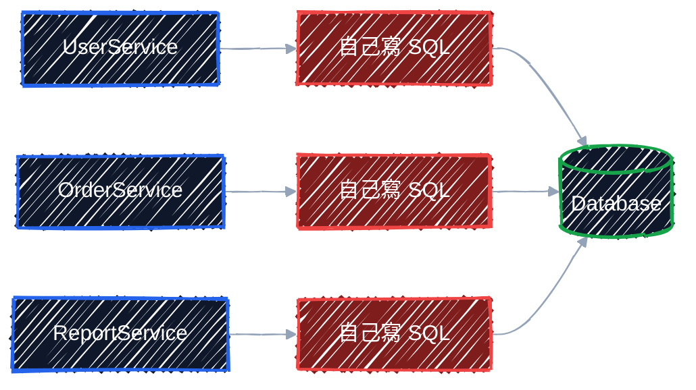
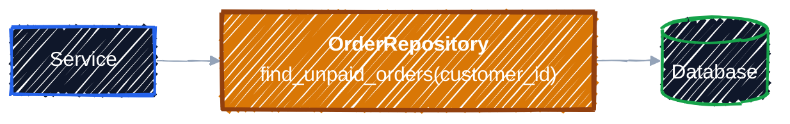
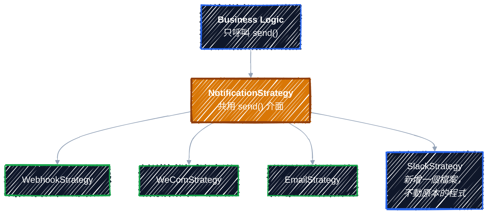
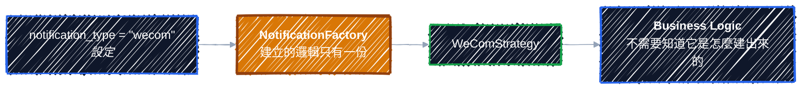

# Q74: Which design patterns do you actually use?

> Tests whether a pattern shows up because a problem demanded it, or because the question asked. Naming Singleton without its downside is the failure mode.

**Part:** Code Design | **Importance:** 6/10 | **Status:** Complete

**New to these terms?** [unit test](../_glossary.md#unit-test), [dependency injection](../_glossary.md#dependency-injection)

## In One Sentence

A design pattern is not something you apply because it exists - it is the solution people ended up writing down after hitting the same problem enough times, and in backend work the ones that keep coming back are Repository, Strategy, and Factory.

Design Pattern 不是因為它存在就拿來套 —— 它是同一個問題遇到很多次之後，大家自然整理出來的解法；後端開發裡反覆出現的是 Repository、Strategy 和 Factory。

## Answer Shape

Say up front that a pattern comes out of a problem, not out of a book, then take the three one at a time. For each one, describe the pain first and let it get worse over a few months, because the pattern only makes sense once the reader can feel what it is fixing. Chain Factory onto Strategy, since the second question follows directly from the first. Then be careful rather than dismissive about Singleton, and finish on the cost of adding a pattern too early.

先說清楚 pattern 是從問題長出來的，不是從書上抄的，然後三個一個一個講。每一個都先描述痛點，而且讓它隨著時間惡化，因為只有當讀者感覺得到它在修什麼，pattern 才有意義。把 Factory 接在 Strategy 後面，因為第二個問題是從第一個直接延伸出來的。接著對 Singleton 用「小心使用」而不是「一概拒絕」的態度，最後收在太早套用 pattern 的代價。

## Full Spoken Answer

I do not think of design patterns as something you apply because they exist. They are the solutions people ended up writing down after hitting the same problem enough times. So for each one I would name, I would rather describe the problem I kept running into than give the textbook definition. In backend work there are three I reach for regularly: Repository, Strategy, and Factory.

我不會把 design pattern 想成「因為它存在所以拿來套」的東西。它們是同一個問題遇到很多次之後，大家自然整理出來的解法。所以每一個我要講的 pattern，我寧可描述我一直遇到的那個問題，而不是給教科書上的定義。後端開發裡我會經常用到的有三個：Repository、Strategy 和 Factory。

The repository pattern is the one I use most. Say several places in the system need to find a customer's unpaid orders. If every service writes that query itself, after a few months you have three or four nearly identical pieces of SQL scattered around. Then the rule changes - unpaid now excludes cancelled orders - and someone updates A, forgets B, and one of the copies turns out to have been missing a `WHERE` condition the whole time. Nobody notices until a customer is billed for something they cancelled. The queries were never really the same; they just looked the same.

Repository pattern 是我最常用的。假設系統裡有好幾個地方都需要「查出某個客戶還沒付款的訂單」。如果每個 Service 都自己寫這段查詢，幾個月後你會有三、四份長得差不多的 SQL 散在各處。然後某天條件改了 —— 未付款現在不含已取消的訂單 —— 有人改了 A、忘記改 B，而其中一份還被發現從頭到尾就少了一個 `WHERE` 條件。沒有人發現，直到某個客戶為他已經取消的東西被收了錢。這些查詢其實從來就不一樣，只是看起來一樣。

So I put everything that touches Order in the database behind one class, `OrderRepository`. The flow becomes service, then repository, then database. The service does not need to know how the SQL is written; it just calls `find_unpaid_orders(customer_id)`. Now the rule lives in exactly one place, so changing it changes it everywhere. And there is a second benefit that matters just as much: it is much easier to test. The service no longer depends on PostgreSQL, so production hands it a `PostgresOrderRepository` and a unit test hands it a `FakeOrderRepository` that keeps rows in a dict. That is where this connects straight back to dependency injection - Repository is what gives you something worth injecting.

所以我會把所有跟 Order 有關的資料庫操作，收到一個 `OrderRepository` 後面。流程變成 Service → Repository → Database。Service 不需要知道 SQL 怎麼寫，它只要呼叫 `find_unpaid_orders(customer_id)`。現在那條規則只住在一個地方，改一次就到處都改好了。而且還有另一個一樣重要的好處：**它比較好測試**。Service 不再直接依賴 PostgreSQL，所以正式環境給它 `PostgresOrderRepository`，Unit Test 給它一個把資料放在 dict 裡的 `FakeOrderRepository`。這裡就直接接回 dependency injection 了 —— Repository 給了你一個值得注入的東西。

The second is Strategy, and my trigger for it is watching an if/elif chain get longer. Notifications are the example I have actually lived through. At the start there is only one channel, a webhook, so `send_notification()` just posts to a URL. Then the company adds WeCom, so an `if` appears. Then email, so an `elif`. Then someone wants SMS. Six months in, that one function is two hundred lines, four people are editing it at once, and every new channel means modifying code that already works - which is exactly the change most likely to break something unrelated. Strategy splits that into one small class per channel - `WebhookStrategy`, `WeComStrategy`, `EmailStrategy` - all sharing the same `send()` interface. The business logic stops caring which one it is holding; it just calls `send()`. So when Slack comes along, I add a `SlackStrategy` file and register it, instead of making the existing function longer. Each channel is also testable on its own, which the two-hundred-line version never was. It is worth noticing that Strategy is really the interface idea plus injection - most patterns turn out to be combinations of those two rather than separate inventions.

第二個是 Strategy，而我啟動它的訊號是看到一條 if/elif 越來越長。通知功能是我真的經歷過的例子。一開始只有一個管道，Webhook，所以 `send_notification()` 就只是往一個 URL 送。後來公司加了 WeCom，於是多了一個 `if`。再來是 Email，多了一個 `elif`。接著有人要簡訊。六個月後，那一個函式兩百行，四個人同時在改它，而且每加一種通知方式都要去修改「原本就能動的程式」—— 那正是最容易弄壞不相干東西的那種改動。Strategy 的做法是把它拆成一個管道一個小 class —— `WebhookStrategy`、`WeComStrategy`、`EmailStrategy` —— 它們共用同一個 `send()` 介面。Business Logic 不再需要管手上這個到底是哪一個，它只要呼叫 `send()`。所以之後多一個 Slack，我是新增一個 `SlackStrategy` 檔案並註冊它，而不是繼續把原本那個函式加長。而且每個管道都可以單獨測試，這件事在兩百行的版本裡從來做不到。值得注意的是，Strategy 其實就是 interface 加上注入 —— 大部分 pattern 到頭來都是這兩者的組合，而不是各自獨立的發明。

Factory usually shows up right after Strategy, because Strategy answers "there are many ways to do this" and immediately raises the next question: which one do I build? The config says `notification_type = "wecom"`, and if every caller writes its own `if wecom: WeComStrategy() elif email: EmailStrategy()`, then the object-creation logic has scattered in exactly the way the SQL did. So that decision goes into a `NotificationFactory`: config goes in, the right strategy comes out, and the business logic never needs to know how any of them are constructed. The plainest way I can hold the two apart is that Strategy is "there are several ways to do this, which one runs", and Factory is "which one do I create".

Factory 通常緊接在 Strategy 之後出現，因為 Strategy 回答的是「這件事有很多種做法」，而它馬上帶出下一個問題：**那到底要建立哪一個？** 設定寫的是 `notification_type = "wecom"`，如果每個呼叫方都自己寫一段 `if wecom: WeComStrategy() elif email: EmailStrategy()`，那麼「建立物件」的邏輯就用跟剛才 SQL 一模一樣的方式散掉了。所以把這個決定交給 `NotificationFactory`：設定進去，對的 strategy 出來，Business Logic 完全不需要知道它們各自是怎麼建起來的。我用來分辨這兩個最直白的說法是：**Strategy 是「有很多種做法，要用哪一種」，Factory 是「要建立哪一個」。**

Singleton is the one I am careful with rather than one I refuse outright. The problem is not the idea that there should only be one of something - that is often true. The problem is how it usually ends up: a global object that anything can reach for directly. If it holds mutable state, test A changes it and test B fails because of something test A did, which is the worst kind of failure to debug because it passes when you run it alone. And because nothing declares it as a dependency, you cannot tell what a class actually needs by reading its signature. So when something genuinely should exist only once, I still prefer to create it explicitly and pass it in through dependency injection, rather than letting every part of the system reach out and grab a global.

Singleton 是我會小心使用、而不是直接拒絕的那一個。問題不在「某個東西應該只有一份」這個想法 —— 那經常是對的。問題在於它最後通常會變成什麼：一個大家都可以直接拿來用的 global object。如果它裡面又有 mutable state，那麼測試 A 改了它的狀態，測試 B 就會因為測試 A 做的事而失敗 —— 而那是最難除錯的一種失敗，因為單獨跑它又會過。而且因為沒有任何地方把它宣告成依賴，你光讀一個 class 的簽章，根本看不出它到底需要什麼。所以當某個東西確實只需要一份時，我還是比較喜歡明確地建立它，再透過 dependency injection 傳給需要它的 Service，而不是讓所有地方自己去抓那個 global。

The last thing I would say is that I do not look at code and ask which pattern to apply. A pattern adds abstraction, and abstraction has a price. Code that was five obvious lines becomes an interface, a factory, and a strategy, and the next person has to open three or four files before they can tell what actually happens. That is a real cost, and it is harder to undo later than it was to add. So my rule is to write the simplest, most direct version first, and extract a pattern only when the same design problem shows up repeatedly, or when the code has genuinely become hard to change or hard to test. The problem earns the pattern.

最後我想說的是，我不會看到程式就先想「這裡要套哪個 pattern」。Pattern 會增加抽象，而抽象是有代價的。原本五行就看得懂的程式，變成一個 interface、一個 factory、一個 strategy，下一個人要開三四個檔案才知道真正做了什麼。那是實實在在的代價，而且事後要拆掉比當初加上去還難。所以我的原則是：**先用最簡單、最直白的方式寫；等到同一種設計問題重複出現，或程式真的開始難改、難測，再把 pattern 抽出來。** 是問題讓 pattern 有資格出現。

## Quick Reference

**Repository - before: SQL spread across services:**



**Repository - after: one place owns the query:**



**Strategy - the if/elif stops growing:**

```python
# ❌ 一開始只有 Webhook，然後一種一種加上去
def send_notification(type, msg):
    if   type == "webhook": ...     # 每加一種通知方式，
    elif type == "wecom":   ...     # 就要去改「原本就能動」的程式
    elif type == "email":   ...
    elif type == "sms":     ...     # 六個月後兩百行，四個人同時在改
```



**Factory - the next question after Strategy:**



**The three, in the plainest form:**

| Pattern | The problem, in one line | The question it answers |
|---|---|---|
| **Repository** | SQL 不要散得到處都是 | Where does the query live? |
| **Strategy** | if/elif 一直長大，把不同做法拆開 | Which way of doing it runs? |
| **Factory** | 建立物件的邏輯不要散得到處都是 | Which one do I create? |

> Remember the problem rather than the definition. If the name goes blank under pressure, you can still rebuild the whole answer from "what was it fixing".

**Singleton - the one to be careful with:**

| | |
|---|---|
| **The idea** | "There should only ever be one of these" - often genuinely true |
| **What it becomes** | A global object anything can reach for directly |
| **Cost 1** | Mutable state: test A changes it, test B fails - and passes when run alone |
| **Cost 2** | The dependency is hidden, so a class's signature no longer tells you what it needs |
| **In Python** | A module-level object already is one - the pattern itself adds nothing |
| **Prefer** | Create it once explicitly, then inject it into whoever needs it |

## Interview Version

> Patterns are what people wrote down after hitting the same problem enough times, so I would describe the problem rather than the definition. Repository: if several services each write their own unpaid-orders query, you end up with three or four near-identical pieces of SQL, and when the rule changes someone updates one and misses another. Putting every Order database operation behind an `OrderRepository` means the rule lives in one place, and the service can be handed a `FakeOrderRepository` in a test - which is where it meets dependency injection. Strategy: notifications start as just a webhook, then WeCom is added, then email, and the if/elif chain grows until every new channel means editing code that already works. One small class per channel behind a shared `send()` makes adding Slack a new file instead of a longer function. Factory follows directly from Strategy, because once there are many ways to do something the next question is which one to build - otherwise every caller writes its own `if wecom ... elif email ...` and the creation logic scatters exactly as the SQL did. The plainest split is that Strategy is which way of doing it runs, and Factory is which one gets created. Singleton I am careful with rather than refusing: it usually becomes a global object with mutable state, so test A breaks test B and the dependency is hidden from the signature. And I write the direct version first, because abstraction has a price - five obvious lines becoming an interface, a factory, and a strategy means the next person opens four files to find out what happens.

面試時可回答：pattern 是同一個問題遇到很多次之後，大家寫下來的解法，所以我會描述問題而不是定義。Repository：如果好幾個 Service 各自寫自己的「查出這個客戶未付款的訂單」，最後會有三、四份幾乎一樣的 SQL，而條件一改，有人改了這份、漏了那份。把所有 Order 的資料庫操作收到 `OrderRepository` 後面，規則就只住在一個地方，而且 Service 在測試時可以拿到 `FakeOrderRepository` —— 這裡就跟 dependency injection 接上了。Strategy：通知一開始只有 Webhook，後來加 WeCom、再加 Email，if/elif 一路長大，直到每加一種通知方式都得去改「原本就能動的程式」。拆成一個管道一個小 class、共用一個 `send()`，之後多一個 Slack 就是新增檔案，而不是把函式加長。Factory 是從 Strategy 直接延伸出來的，因為既然有很多種做法，下一個問題就是要建立哪一個 —— 否則每個呼叫方都自己寫 `if wecom ... elif email ...`，建立的邏輯就用跟剛才 SQL 一樣的方式散掉了。最直白的分法是：Strategy 是「要用哪一種做法」，Factory 是「要建立哪一個」。Singleton 我是小心使用而不是拒絕：它通常會變成一個帶著 mutable state 的 global object，於是測試 A 弄壞測試 B，而且依賴在簽章上看不到。另外我會先寫直白的版本，因為抽象是有代價的 —— 原本五行看得懂的東西變成 interface、factory、strategy，下一個人要開四個檔案才知道到底發生了什麼。

The sentence to remember is: **Repository keeps SQL from spreading, Strategy splits a growing if/elif into separate implementations, and Factory keeps object creation from spreading - remember the problem and you can rebuild the answer without the definition.**

最值得記：**Repository 是「SQL 不要散得到處都是」，Strategy 是「if/elif 一直長大就把做法拆開」，Factory 是「建立物件的邏輯不要散得到處都是」—— 記住問題，就算忘了定義也能把整個答案講回來。**

---

| ⬅ Previous | Home | Next ➡ |
|---|---|---|
| [Q34: How do you ensure your backend code is maintainable and easy to understand?](../architecture-and-scaling/q34-maintainable-backend-code.md) | [All 52 questions](../../README.md) | [Q81: How does your team run its development process?](../process-and-collaboration/q81-how-your-team-runs-development.md) |
