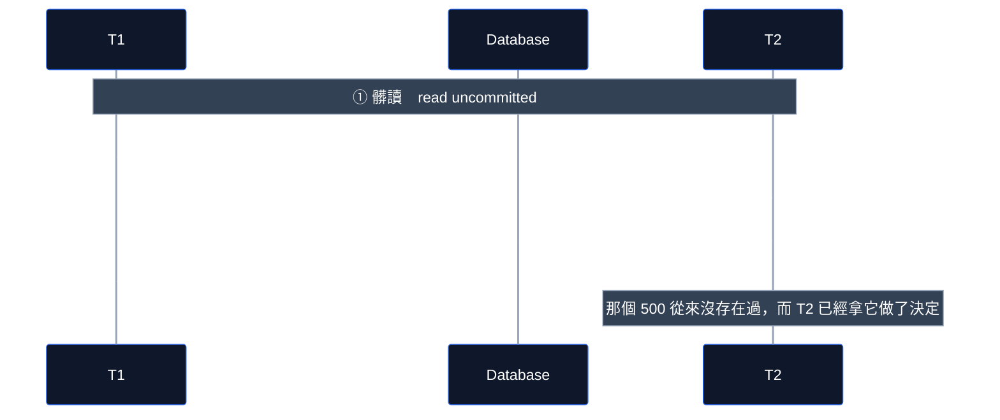
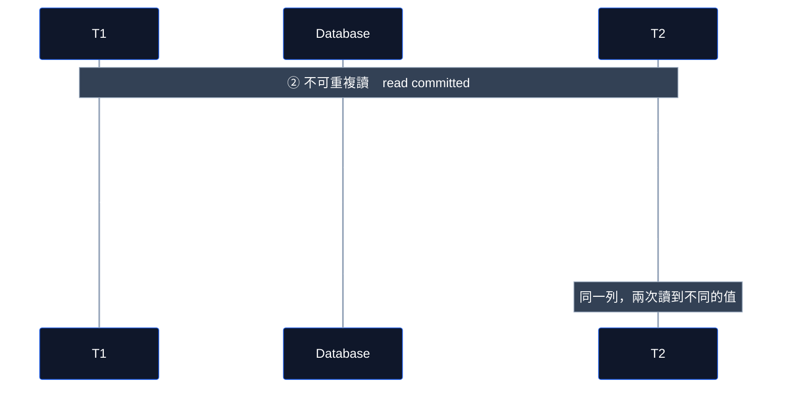
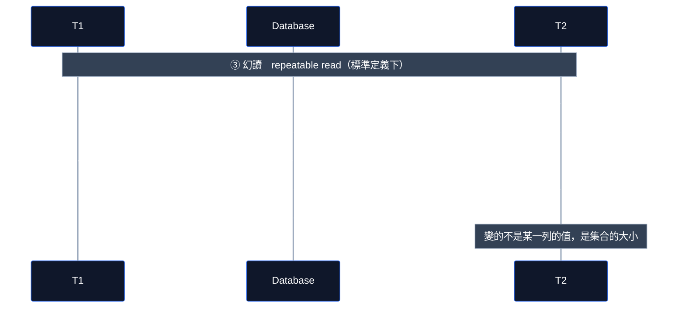
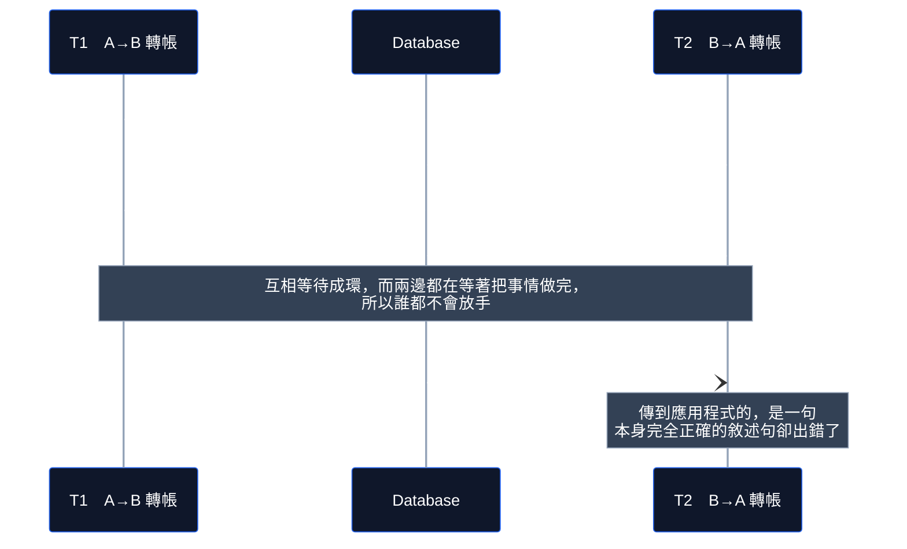
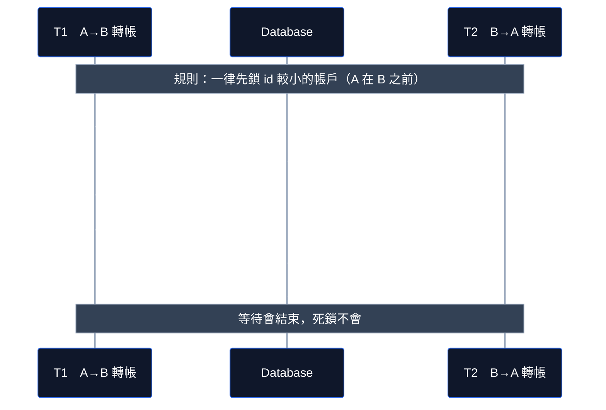

# Q17: Explain database transactions and isolation levels.

> Tests whether you know what your default isolation level actually allows, and whether you can recognise a deadlock and say what causes one.

**Part:** Databases | **Importance:** 9/10 | **Status:** Complete

**New to these terms?** [orm](../_glossary.md#orm), [timeout](../_glossary.md#timeout)

## In One Sentence

A transaction groups several statements so they either all take effect or none do, and the isolation level decides how much of other in-flight transactions your transaction is allowed to see.

交易把多個敘述句綁成一組，讓它們要嘛全部生效、要嘛全部不生效；而隔離級別決定你的交易能看到多少其他進行中交易的內容。

## Answer Shape

Start with ACID but spend the time on the I, because atomicity is intuitive and isolation is where the interview actually goes. Walk one bank account through the four levels instead of defining them, naming the anomaly each level removes. Give the three anomalies a one-line hook each, because that is what survives the nerves. Say what your database actually defaults to, then finish with deadlocks - and show one happening, since the rule "lock in a consistent order" means nothing until you have seen the order go wrong.

從 ACID 開始，但把時間花在 I 上，因為不可分割性很直觀，而隔離性才是面試真正會深入的地方。用一個銀行帳戶走過四個級別，而不是把它們定義一遍，並點出每一級消除掉哪個異常。給三個異常各一句記憶口訣，因為那才是緊張時還記得住的東西。說出你的資料庫實際預設哪一級，最後收在死鎖 —— 而且要演一次給人看，因為「用一致的順序取鎖」這條規則，在你沒看過順序出錯之前是沒有意義的。

## Full Spoken Answer

A transaction is a unit of work that satisfies ACID. Atomicity means all of it commits or none of it does, so a transfer cannot debit one account without crediting the other. Consistency means the database moves from one valid state to another, with constraints upheld. Durability means once you get the commit acknowledgement, the change survives a crash. Those three are rarely argued about. Isolation is the interesting one, because it is not a single guarantee but a dial - and every level of that dial is answering the same question: how much of what another transaction is doing right now am I allowed to see?

交易是一個滿足 ACID 的工作單位。不可分割性代表全部提交或全部不提交，所以轉帳不可能扣了一邊卻沒加另一邊。一致性代表資料庫從一個有效狀態移動到另一個有效狀態，約束條件維持成立。持久性代表一旦你收到提交確認，這個變更就能撐過當機。這三項很少有爭議，有趣的是隔離性，因為它不是單一的保證，而是一個可以調的旋鈕 —— 而這個旋鈕的每一格，回答的都是同一個問題：**另一個交易此刻正在做的事，我可以看到多少？**

The four levels stick much better as one running story than as four definitions, so picture a single bank account with a balance of 1000. At read uncommitted, another transaction sets it to 500 and has not committed yet, and you already see 500. That is a dirty read, and the word to remember is uncommitted - if that other transaction rolls back, you made a decision based on a number that never existed. Read committed fixes it by refusing to show you the 500 until it is committed, which is why almost nobody runs read uncommitted. But now read the balance twice inside your own transaction, and let someone commit an update in between: your first read says 1000, your second says 500. That is a non-repeatable read, and the phrase to hold is the same row changed value underneath me.

四個級別用一個連貫的故事記，比背四條定義好記太多，所以想像一個銀行帳戶，餘額 1000。在 read uncommitted 下，另一個交易把它改成 500、還沒提交，而你已經看到 500。這是**髒讀**，要記的關鍵字是「還沒提交」—— 如果對方之後回滾，你就是根據一個從來不存在的數字做了決定。read committed 的修法是在它提交之前不給你看那個 500，這也是為什麼幾乎沒有人真的在跑 read uncommitted。但現在，在你自己的交易裡讀兩次餘額，中間讓別人提交一筆更新：你第一次讀到 1000，第二次讀到 500。這是**不可重複讀**，要記的一句是「同一列的值在我腳下變了」。

Repeatable read fixes that by pinning the row, so both reads say 1000. What it classically cannot pin is the whole result set. Query orders where amount is over 1000 and get 10 rows; someone commits an 11th row that also matches; run the identical query again and get 11. That is a phantom read, and the phrase is the same query returned a different number of rows - it is not one row's value changing, it is the set growing. Serializable removes even that, behaving as if one transaction ran completely before the other started. So the progression is simple: each level removes exactly one more anomaly than the one below it.

repeatable read 的修法是把那一列釘住，所以兩次都讀到 1000。它傳統上釘不住的是「整組結果」。查詢 orders 裡金額大於 1000 的，得到 10 列；有人提交了第 11 列也符合條件的資料；同樣的查詢再跑一次，變成 11 列。這是**幻讀**，要記的一句是「同一個查詢回傳的列數不一樣了」—— 變的不是某一列的值，是那個集合變大了。serializable 連這個都消除，表現得就像一個交易完全跑完，另一個才開始。所以整個進程很單純：**每升一級，就比下一級多擋掉剛好一個異常。**

Two practical notes are worth having ready. The default differs by engine - PostgreSQL and Oracle default to read committed, MySQL with InnoDB defaults to repeatable read - so the same application code can genuinely behave differently on the two. And the levels are defined by which anomalies they must prevent, not by how they are implemented, so real databases are often stricter than the standard requires. Both Postgres and InnoDB get their stability from MVCC rather than from locking readers: a plain SELECT reads from a consistent snapshot, so rows committed by anyone else afterwards are simply invisible to it. Two details are worth getting right, because they are where the glib version is wrong. The snapshot is taken at the transaction's first statement rather than at BEGIN - and under read committed a fresh one is taken per statement, which is exactly why the same query can return different rows twice. InnoDB's next-key locking is what blocks phantoms for locking reads, meaning SELECT FOR UPDATE, UPDATE and DELETE; plain reads avoid them through the snapshot instead. PostgreSQL implements serializable optimistically with SSI, aborting a transaction rather than blocking it on the way.

有兩點實務筆記值得先準備好。預設值因引擎而異 —— PostgreSQL 和 Oracle 預設 read committed，MySQL 搭 InnoDB 預設 repeatable read —— 所以同一份應用程式碼在兩者上的行為真的會不一樣。而且這些級別是用「必須阻止哪些異常」定義的，不是用實作方式定義，所以真實的資料庫常常比標準更嚴格。Postgres 和 InnoDB 的穩定性都來自 **MVCC，而不是把讀者鎖住**：一個普通的 SELECT 讀的是一份一致快照，所以之後任何人提交的資料列對它來說根本不存在。有兩個細節值得講準確，因為含糊的版本就是錯在這裡。**快照是在交易的第一句敘述時拍的，不是在 BEGIN 的時候** —— 而在 read committed 之下，是每一句敘述各拍一張新的，這正是為什麼同一個查詢會回傳不同的結果。**InnoDB 的 next-key locking 擋的是「當前讀」的幻讀**，也就是 SELECT FOR UPDATE、UPDATE 和 DELETE；普通的讀取是靠快照避開幻讀，機制不一樣。PostgreSQL 的 serializable 則是用 SSI 做樂觀實作，做法是中止交易而不是一路阻塞它。

The follow-up is almost always deadlocks, and the clearest way to answer is to show one rather than define it. Two transfers happen at the same moment: transaction one moves money from account A to account B, transaction two moves money from B to A. Transaction one updates A first, which locks row A. Transaction two updates B first, which locks row B. Now transaction one asks for B and waits, because transaction two is holding it - and transaction two asks for A and waits, because transaction one is holding it. Neither will ever release, because each is waiting to finish. The database detects the cycle, kills one of them, and what reaches your application is an error on a statement that was perfectly correct. That last part is why deadlocks confuse people: nothing in the failing query is wrong.

接下來的追問幾乎一定是死鎖，而最清楚的回答方式是**演一次給對方看**，不是定義它。兩筆轉帳同時發生：交易一把錢從帳戶 A 轉到帳戶 B，交易二把錢從 B 轉到 A。交易一先更新 A，於是鎖住了 A 這一列。交易二先更新 B，於是鎖住了 B 這一列。現在交易一去要 B，只能等，因為 B 在交易二手上；而交易二去要 A，也只能等，因為 A 在交易一手上。兩邊永遠不會放手，因為它們各自都在等著把事情做完。資料庫偵測到這個循環，殺掉其中一個，而傳到你的應用程式的，是「一個完全正確的敘述句卻出錯了」。**最後這一點正是死鎖讓人困惑的原因：那句失敗的查詢本身沒有任何問題。**

How does the database even know it happened? There are two mechanisms, and it is worth knowing which one you are relying on. The usual one is active detection: the database keeps a graph of who is waiting for whom, and a deadlock is simply a cycle in that graph, so it is spotted the moment the cycle closes and one transaction is killed straight away. You do not get to choose which one - InnoDB kills whichever is cheaper to roll back - so both sides of your code have to be able to retry. The fallback is a plain timeout: no graph, just waiting, and giving up after `innodb_lock_wait_timeout`, which defaults to fifty seconds. The difference in one line is that detection notices and kills at once, while a timeout waits until it gives up. Detection is far better for users, and the only reason to turn it off is extreme write concurrency, where scanning that graph every time someone starts waiting becomes a bottleneck of its own.

那資料庫到底怎麼知道死鎖發生了？有兩種機制，而且值得知道你靠的是哪一種。常見的是**主動偵測**：資料庫內部維護一張「誰在等誰」的圖，而死鎖其實就是這張圖裡出現了一個環，所以環一閉合就會被發現，立刻殺掉其中一個交易。你沒得選是哪一個 —— InnoDB 會挑回滾成本比較小的那個 —— 所以你的程式兩邊都要能重試。退路是**單純的逾時**：不找環，就是等，等超過 `innodb_lock_wait_timeout`（預設 50 秒）就放棄。一句話講完差別：**偵測是「馬上發現、馬上殺」，逾時是「等到受不了才放棄」。** 偵測對使用者好太多，唯一會關掉它的理由是寫入併發量極高 —— 那時候每次有人開始等就要掃一次圖，掃圖本身反而變成瓶頸。

Seeing it that way makes the fixes obvious rather than something to memorise, and they come in three layers: prevent it, make it less likely, and handle it when it happens anyway. The cause is two code paths taking the same locks in opposite order, so prevention is to always take them in a consistent order - in that example, always lock the lower account id first. Then both transactions lock A first, and the second one simply waits for the first to finish. Waiting ends; a deadlock does not. But you cannot always control the order - an ORM or a foreign-key check can take locks you never wrote - so the second layer is to lower the odds by keeping transactions short, because a lock is held from the moment it is taken until commit, so a transaction that calls an external API in the middle is holding rows hostage for the whole round trip; the shorter the window, the less chance two transactions overlap in it. And since neither layer gets the chance to zero, the third layer is what to do when it happens: treat the deadlock error as retryable rather than fatal - roll back and retry - since the database has already rolled that transaction back and retrying usually succeeds. And the closing position on isolation generally: use the weakest level that is still correct for the operation, and raise it deliberately where money or inventory is involved, because higher isolation is paid for in concurrency.

這樣看過一次之後，修法就變成理所當然的，而不是要背的東西，而且分成三層：**預防、降低機率、真的發生了怎麼處理。** 成因是兩條程式路徑用**相反的順序**拿同一批鎖，所以**預防**就是永遠用一致的順序拿 —— 在剛才的例子裡，就是一律先鎖 id 比較小的那個帳戶。這樣兩個交易都會先鎖 A，第二個就只是等第一個做完而已。**等待會結束，死鎖不會。** 但順序不一定都在你的掌控中 —— ORM 或外鍵檢查可能會拿你沒寫到的鎖 —— 所以第二層是**降低機率**：讓交易保持短小，因為鎖從被拿到的那一刻一直持有到提交，所以一個中間還去呼叫外部 API 的交易，等於在整趟往返期間都把那些資料列扣在手上；持鎖的時間窗越短，兩個交易撞在一起的機會就越小。而既然前兩層都沒辦法把機率降到零，第三層就是**真的發生時怎麼辦**：把死鎖錯誤當成可重試的而不是致命的 —— rollback 再 retry —— 因為資料庫已經幫你把那個交易回滾了，重試通常就會成功。至於隔離性整體的收尾立場：**用「仍然正確」的最弱級別，在牽涉金錢或庫存時才刻意調高**，因為更高的隔離性是用併發度換來的。

## Quick Reference

**The three anomalies, in one line each:**

| Anomaly | What changed under you | 一句話 |
|---|---|---|
| **Dirty read** | You saw data that was never committed | 看到別人**還沒 commit** 的資料 |
| **Non-repeatable read** | The same row came back with a different value | **同一列**，讀兩次值不一樣 |
| **Phantom read** | The same query came back with more rows | **同一個查詢**，列數不一樣 |

**Watching each one happen:**

**The dial:**

| Level | Dirty read | Non-repeatable read | Phantom read | Typical default |
|---|---|---|---|---|
| **Read uncommitted** | ✅ possible | ✅ possible | ✅ possible | rarely used |
| **Read committed** | ❌ prevented | ✅ possible | ✅ possible | PostgreSQL, Oracle, SQL Server |
| **Repeatable read** | ❌ prevented | ❌ prevented | ✅ possible in the standard | MySQL / InnoDB |
| **Serializable** | ❌ prevented | ❌ prevented | ❌ prevented | opt in when correctness demands it |

✅ = the anomaly can still occur at this level. Each level removes exactly one more than the one below it.

**The gotcha inside repeatable read - snapshot read vs current read:**

A plain `SELECT` reads the snapshot. A write reads the **latest committed** row, not your snapshot. So inside one repeatable-read transaction on InnoDB:

| Statement | What it sees | Why |
|---|---|---|
| `SELECT balance` | 1000 - your snapshot | Snapshot read (MVCC), consistent for the whole transaction |
| Someone else commits `balance = 500` | - | Invisible to your `SELECT` |
| `SELECT balance` again | Still 1000 | Repeatable read is doing its job |
| `UPDATE … SET balance = balance - 100` | Operates on **500**, not 1000 | Current read - a write must act on the row that exists now |
| `SELECT balance` after that | 400 | You just wrote it, so you can see it |

So reading a value and then writing based on it is **not** safe just because the isolation level is repeatable read. If the write depends on the value you read, take the lock when you read it - `SELECT … FOR UPDATE` - or use a single atomic statement.

**A deadlock, and why the fix is what it is:**

The fix follows from the picture: take the locks in the same order every time, and the cycle cannot form.

**How the database notices:**

| | Active detection | Lock wait timeout |
|---|---|---|
| **How** | Keeps a graph of who waits for whom; a deadlock is a cycle in it | No graph - just waits |
| **When it acts** | The moment the cycle closes | After `innodb_lock_wait_timeout` (default 50s) |
| **In one line** | 馬上發現、馬上殺 | 等到受不了才放棄 |
| **Which transaction dies** | InnoDB picks whichever is cheaper to roll back - so **both** paths must be able to retry | The one that ran out of patience |
| **Turn it off when** | Extreme write concurrency, where scanning the graph is itself the bottleneck | - |

| Layer | Deadlock fix | Why it works |
|---|---|---|
| **Prevent** 預防 | Take locks in a consistent order (e.g. lower id first) | Removes the cycle - the second transaction waits instead of blocking the first |
| **Make it less likely** 降低機率 | Keep transactions short | A lock is held from acquisition until commit; never call an external API mid-transaction |
| **When it happens anyway** 真的發生 | Rollback + retry on the deadlock error | The database already rolled that transaction back, so a retry usually succeeds |

## Interview Version

> A transaction is a unit of work satisfying ACID: atomicity means all of it commits or none does, consistency means constraints are upheld, durability means the change survives a crash once acknowledged. Isolation is the interesting one, because it is a dial rather than a single guarantee, and every level answers the same question - how much of what another transaction is doing right now am I allowed to see. I would walk one account through it. Balance 1000. At read uncommitted, someone sets it to 500 without committing and you already see 500 - a dirty read, and if they roll back you decided on a number that never existed. Read committed hides it until commit, but read twice in your own transaction with a commit in between and you get 1000 then 500 - a non-repeatable read, the same row changing value. Repeatable read pins the row, but classically not the result set: a query returning 10 rows returns 11 after someone inserts a matching row - a phantom, the same query returning a different number of rows. Serializable removes that too. So each level removes exactly one more anomaly. Worth knowing that the default differs by engine - PostgreSQL read committed, MySQL InnoDB repeatable read - so the same code behaves differently on each. The follow-up is usually deadlocks, and I would show one: two transfers at once, A to B and B to A. The first locks row A, the second locks row B, then each asks for the row the other is holding, and neither will release because each is waiting to finish. The database keeps a graph of who is waiting for whom, spots the cycle, and kills one - whichever is cheaper to roll back, which you do not control, so both paths have to be able to retry. What you see is an error on a statement that was perfectly correct. That makes the fixes obvious, in three layers. Prevent it by taking locks in a consistent order - always the lower account id first, so the second transaction simply waits, and waiting ends where a deadlock does not. Make it less likely by keeping transactions short, so locks are not held across an external call. And when it happens anyway, treat the deadlock error as retryable rather than fatal - the database has already rolled back, so you just retry.

面試時可回答：交易是一個滿足 ACID 的工作單位：不可分割性代表全部提交或全部不提交，一致性代表約束被維持住，持久性代表一旦收到提交確認就撐得過當機。有趣的是隔離性，因為它是一個旋鈕而不是單一保證，而每一格回答的都是同一個問題 —— 另一個交易此刻正在做的事，我可以看到多少。我會用一個帳戶走一遍。餘額 1000。在 read uncommitted，有人把它設成 500 但沒提交，你就已經看到 500 —— 這是髒讀，而如果對方回滾，你就是根據一個從來不存在的數字做了決定。read committed 在提交前把它藏起來，但你在自己的交易裡讀兩次、中間有人提交，就會先讀到 1000 再讀到 500 —— 這是不可重複讀，同一列的值變了。repeatable read 把那一列釘住，但傳統上釘不住整組結果：一個回傳 10 列的查詢，在有人插入一筆符合的資料之後變成 11 列 —— 這是幻讀，同一個查詢回傳的列數不一樣了。serializable 連這個也消除。所以每升一級，就剛好多擋掉一個異常。值得知道預設值因引擎而異 —— PostgreSQL 是 read committed，MySQL InnoDB 是 repeatable read —— 所以同一份程式碼在兩邊行為不同。接下來的追問通常是死鎖，我會直接演一次：兩筆轉帳同時發生，A 轉 B 和 B 轉 A。第一個鎖住 A 這一列，第二個鎖住 B 這一列，然後各自去要對方手上那一列，而誰都不會放手，因為它們都在等著把事情做完。資料庫維護一張「誰在等誰」的圖，偵測到環就殺掉其中一個 —— 挑回滾成本比較小的那個，而那不是你能控制的，所以兩條路徑都要能重試。你看到的就是「一句完全正確的敘述句卻出錯」。這樣修法就很明顯了，分三層。**預防**靠固定鎖順序 —— 一律先鎖 id 較小的帳戶，這樣第二個交易就只是等，而等待會結束、死鎖不會。**降低機率**靠縮短交易，不要跨著外部呼叫持鎖。**真的發生了**就靠 rollback + retry —— 資料庫已經幫你回滾了，重試就好，不要當成致命錯誤。

The sentence to remember is: **Dirty read is data not committed yet, non-repeatable read is the same row changing value, phantom read is the same query returning more rows - each level removes one more, and a deadlock is just two transactions taking the same locks in opposite order: prevent it with a fixed lock order, make it rarer with short transactions, and when it happens anyway, roll back and retry.**

最值得記：**髒讀是看到還沒 commit 的資料，不可重複讀是同一列的值變了，幻讀是同一個查詢的列數變了 —— 每升一級就多擋掉一個；而死鎖就只是兩個交易用相反的順序拿同一批鎖：預防靠固定鎖順序、降低機率靠縮短交易、真的發生則靠 rollback + retry。**

---

| ⬅ Previous | Home | Next ➡ |
|---|---|---|
| [Q07: What measures would you take to secure a newly developed API?](../api-and-http/q07-securing-a-new-api.md) | [All 52 questions](../../README.md) | [Q18: What is the N+1 query problem, and how do you fix it?](q18-n-plus-one-queries.md) |
