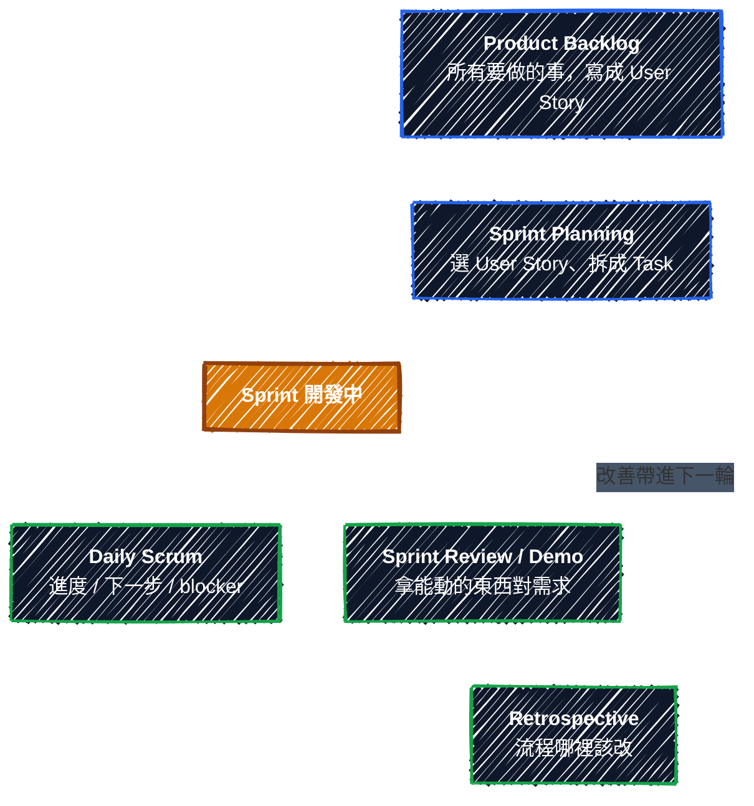

# Q81: How does your team run its development process?

> Usually asked as 'are you familiar with Scrum'. Listing the ceremonies is the floor; saying what breaks without each one is the answer.

**Part:** Process & Collaboration | **Importance:** 6/10 | **Status:** Complete

**New to these terms?** [schema migration](../_glossary.md#schema-migration), [expand and contract](../_glossary.md#expand-and-contract)

## In One Sentence

Scrum cuts the work into short fixed cycles called sprints, and each sprint delivers a piece that actually works, instead of everything arriving at the end of the project.

Scrum 把開發工作切成一個一個短的固定週期，也就是 Sprint，每個 Sprint 都交付一部分真的能用的功能，而不是等整個專案做完才一次交付。

## Answer Shape

Describe the cycle in order, because the order is the answer and it is easy to say out loud. Then go one layer down and say what each ceremony prevents, since anyone can list four meetings. Separate the method from the tool explicitly, because that distinction is where people show they have actually used it. Have the backend-specific follow-up ready - a three-week migration does not fit in a two-week sprint - and finish on what the point actually is.

按順序描述整個循環，因為順序就是答案，而且很好講出口。接著往下一層，說明每個儀式在防止什麼，因為四個會議誰都列得出來。明確把方法和工具分開，因為那個區別正是「真的用過」會顯現的地方。備好後端特有的追問 —— 三週的 migration 塞不進兩週的 sprint —— 最後收在「這整件事的重點到底是什麼」。

## Full Spoken Answer

Scrum is a way of running Agile development, and the core idea is the sprint: a short fixed window, usually one to two weeks, at the end of which something is genuinely deliverable. That is the part that matters. You are not waiting until the whole project is finished to find out whether it was right.

Scrum 是一種跑 Agile 開發的方式，核心概念是 Sprint：一個短的固定週期，通常一到兩週，週期結束時要有真的能交付的東西。重點在這裡 —— 你不是等整個專案做完，才去發現當初的方向對不對。

The flow is easy to walk through in order. Everything that needs doing sits in the Product Backlog, usually written as User Stories. In Sprint Planning the team picks which stories go into this sprint and breaks them into Tasks. During the sprint the team builds, with a Daily Scrum to sync what was done, what is next, and whether anyone is blocked. At the end there is a Sprint Review or demo to check what actually got finished against what was asked for, and then a Retrospective on the process itself - what went well, what should change - and whatever comes out of that carries into the next sprint.

整個流程照順序走一遍就很清楚。所有要做的事放在 **Product Backlog**，通常寫成 User Story。**Sprint Planning** 時團隊決定這個 Sprint 要做哪些 Story，再拆成 Task。Sprint 期間團隊開發，並用 **Daily Scrum** 同步做完了什麼、接下來要做什麼、有沒有人卡住。結束時做 **Sprint Review / Demo**，拿實際完成的東西去對需求；接著是 **Retrospective**，回顧流程本身 —— 哪裡好、哪裡該改 —— 而得出的改善會帶到下一個 Sprint。

Listing those four meetings is the floor, though. What makes the answer worth something is saying what each one prevents. The sprint is a fixed window whose job is to stop the scope moving mid-flight, because when priorities change daily nothing ever finishes. Planning commits to what the window can hold rather than what everyone wants. The Daily surfaces a blocker within a day instead of on the last afternoon. And the Retro is the only ceremony that changes the process itself - it is also the first one teams drop when they are busy, which is exactly why some teams run Scrum for three years without getting any better at it.

不過，列出這四個會議只是及格線。讓答案有價值的，是說出**每一個在防止什麼**。Sprint 是一個固定視窗，它的任務是**讓範圍停止中途變動**，因為優先序天天變的時候，什麼都完不成。Planning 承諾的是「這個視窗裝得下的量」，不是「大家想要的量」。Daily 讓一個卡住的問題在一天內浮上來，而不是拖到最後一個下午。而 Retro 是**唯一會改變流程本身的儀式** —— 它同時也是團隊一忙就第一個砍掉的，這正是為什麼有些團隊跑了三年 Scrum，卻一點也沒變好。

Then the tool, and it is worth being explicit that the tool is not the method. We use Azure DevOps to run this: User Stories with their Acceptance Criteria and Tasks are created there, assigned to an iteration, and the board moves them through To Do, In Progress and Done. So Scrum is the method and ADO is what records and tracks it - the same process runs just as well on Jira or GitLab. Worth knowing the related distinction too: Acceptance Criteria are what makes one story complete, while the Definition of Done is the team standard every story has to meet, like tests written, review passed, documentation updated.

接著是工具，而且值得明講：**工具不是方法**。我們用 Azure DevOps 來跑這一套 —— User Story 連同它的 Acceptance Criteria 和 Task 都建在上面，排進某個 Iteration，開發過程用 Board 把它們從 To Do 推到 In Progress 再到 Done。所以 **Scrum 是方法，ADO 是記錄和追蹤它的工具** —— 同一套流程用 Jira 或 GitLab 跑也一樣。順帶值得知道一個相關的區別：**Acceptance Criteria 是「這一個 Story 算不算完成」，Definition of Done 則是每個 Story 都要滿足的團隊標準**，例如測試寫了、review 過了、文件更新了。

The follow-up that actually tests whether you have lived it is a backend one: what about work that does not fit in two weeks? A database migration that takes three weeks is the usual example, and the answer is not to ask for a longer sprint - it is to break it into steps that are each independently shippable, which is exactly the expand-and-contract approach: add the new column, dual-write, backfill, switch reads, drop the old one, each of those landing in its own sprint and each safe on its own. The other one is interruption. If the team is on call, incidents will eat capacity, so you subtract that capacity up front rather than pretending it will not happen. And if every single sprint gets derailed, the honest conclusion is that the sprint length is wrong, or that this team's work is unpredictable enough that Kanban fits it better than Scrum.

真正能測出你有沒有實際跑過的追問是一個後端問題：那些兩週裝不下的工作怎麼辦？最常見的例子是一個要做三週的資料庫遷移，而答案不是去要一個更長的 Sprint —— 是**把它拆成每一步都能獨立上線的步驟**，也就是 expand and contract 的做法：加新欄位、雙寫、回填、切換讀取、移除舊的，每一步各自落在自己的 Sprint 裡，而且每一步單獨看都是安全的。另一個是中斷。如果團隊要 on-call，事故一定會吃掉產能，所以要**事先把那部分產能扣掉**，而不是假裝它不會發生。而如果每一個 Sprint 都被打亂，誠實的結論是：Sprint 長度設錯了，或者這個團隊的工作不可預期到 Kanban 比 Scrum 更適合它。

Finish on what the point is, and it is worth being honest about the failure modes too. Scrum goes wrong when the ceremonies become theatre - the Daily turning into a status report for a manager rather than a way to unblock each other, story points being treated as a promise rather than an estimate, and Retro actions that nobody ever follows up. What I care about is not the number of meetings. It is that a large requirement gets broken into pieces small enough to finish in a short cycle, so we ship continuously, get feedback continuously, and find out early when something is wrong or pointed in the wrong direction.

最後收在「重點是什麼」，而且也值得誠實講出它的失敗模式。Scrum 會走鐘，是在儀式變成形式的時候 —— Daily 變成向主管報進度，而不是互相解除阻塞；點數被當成承諾而不是估計；Retro 提出的改善沒有人追蹤。我在意的不是會議的數量。**我在意的是一個大的需求有沒有被拆成短週期內完成得了的小塊**，這樣我們就能持續交付、持續拿到 feedback，並且在方向錯掉的時候早一點發現。

## Quick Reference

**The cycle:**

**What each ceremony prevents - this is the half that earns points:**

| Ceremony | What it is for | Without it |
|---|---|---|
| **Sprint** | A fixed window | 範圍中途一直變，優先序天天換，什麼都完不成 |
| **Sprint Planning** | Commit to what the window holds | 承諾的是大家想要的量，不是做得完的量 |
| **Daily Scrum** | Surface blockers within a day | 卡住的事拖到最後一個下午才被發現 |
| **Sprint Review** | Check working software against the ask | 用投影片交差，需求對不對沒人知道 |
| **Retrospective** | The only ceremony that changes the process | 跑了三年 Scrum，流程一點沒變好 |

**Scrum is the method, the tool only records it:**

| Scrum | Azure DevOps |
|---|---|
| Product Backlog | Backlog |
| User Story | User Story / PBI |
| Sprint | Iteration / Sprint |
| Task | Task |
| 開發進度 | Board: To Do → In Progress → Done |

The same process runs on Jira or GitLab. Naming the mapping is what shows you ran it rather than read about it.

**Two distinctions worth having ready:**

| | Means | Scope |
|---|---|---|
| **Acceptance Criteria** | This story is complete when… | One story |
| **Definition of Done** | Every story must also… (tests, review, docs) | The whole team |

| | Scrum | Kanban |
|---|---|---|
| **Shape of work** | Fixed-length batches | Continuous flow, WIP limited |
| **Fits when** | Requirements are stable enough to plan a window | Work arrives unpredictably - ops, support |

**The backend follow-ups:**

| Question | Answer |
|---|---|
| A 3-week migration in a 2-week sprint? | Break it into independently shippable steps - add column, dual-write, backfill, switch reads, drop old. That is [expand and contract](../databases/q20-schema-migrations.md) |
| On-call keeps eating the sprint | Subtract that capacity up front instead of pretending it will not happen |
| *Every* sprint gets derailed | The sprint length is wrong, or this work suits Kanban better than Scrum |

## Interview Version

> Scrum is a way of running Agile development, and the core idea is the sprint - a short fixed window, usually one to two weeks, ending with something genuinely deliverable, so you are not waiting until the whole project is done to find out whether it was right. The flow: everything that needs doing sits in the Product Backlog as User Stories; Sprint Planning picks which stories go in this sprint and breaks them into Tasks; the team builds, with a Daily Scrum to sync progress, next steps and blockers; at the end a Sprint Review checks what was finished against what was asked, then a Retrospective on the process itself, and whatever comes out carries into the next sprint. What I would add is what each one prevents - the sprint stops scope moving mid-flight, planning commits to what the window holds rather than what everyone wants, the Daily surfaces a blocker within a day, and the Retro is the only ceremony that changes the process, which is also why teams that drop it run Scrum for years without improving. We use Azure DevOps for this: User Stories with acceptance criteria and tasks, assigned to an iteration, moved across a board through To Do, In Progress and Done. So Scrum is the method and ADO is the tool that records it - the same process runs on Jira or GitLab. For work that does not fit in a sprint, like a three-week migration, the answer is not a longer sprint but breaking it into independently shippable steps, which is expand and contract. And what I actually care about is not the number of meetings - it is that a large requirement gets broken into pieces small enough to finish in a short cycle, so we ship continuously, get feedback continuously, and find out early when the direction is wrong.

面試時可回答：Scrum 是一種跑 Agile 開發的方式，核心概念是 Sprint —— 一個短的固定週期，通常一到兩週，結束時要有真的能交付的東西，這樣你就不是等整個專案做完才發現方向對不對。流程是：所有要做的事放在 Product Backlog，寫成 User Story；Sprint Planning 決定這個 Sprint 要做哪些 Story，再拆成 Task；團隊開發，並用 Daily Scrum 同步進度、下一步和 blocker；結束時做 Sprint Review 拿完成的東西對需求，接著做 Retrospective 回顧流程本身，得出的改善帶到下一個 Sprint。我會多補一句每個儀式在防止什麼 —— Sprint 讓範圍不會中途一直變，Planning 承諾的是視窗裝得下的量而不是大家想要的量，Daily 讓卡住的事一天內浮上來，而 Retro 是唯一會改變流程本身的儀式，這也是為什麼把它砍掉的團隊跑了好幾年 Scrum 卻沒變好。我們用 Azure DevOps 來跑：User Story 連同 Acceptance Criteria 和 Task，排進某個 Iteration，在 Board 上從 To Do 推到 In Progress 再到 Done。所以 Scrum 是方法，ADO 是記錄它的工具 —— 同一套流程用 Jira 或 GitLab 也一樣。至於一個 Sprint 裝不下的工作，例如一個三週的資料庫遷移，答案不是把 Sprint 拉長，而是拆成每一步都能獨立上線的步驟，也就是 expand and contract。而我真正在意的不是會議的數量 —— 是一個大需求有沒有被拆成短週期內做得完的小塊，讓我們可以持續交付、持續拿 feedback，在方向錯掉的時候早一點發現。

The sentence to remember is: **Scrum is not about the meetings - it is about breaking a large requirement into pieces small enough to ship inside one short cycle, so feedback arrives early enough to change direction.**

最值得記：**Scrum 的重點不是開會 —— 是把一個大需求拆成「一個短週期內交付得了」的小塊，讓 feedback 早到你還來得及轉向。**

---

| ⬅ Previous | Home | Next ➡ |
|---|---|---|
| [Q74: Which design patterns do you actually use?](../code-design/q74-design-patterns-in-practice.md) | [All 52 questions](../../README.md) | [Q82: What do you do when a requirement changes in the middle of a sprint?](q82-requirements-change-mid-sprint.md) |
