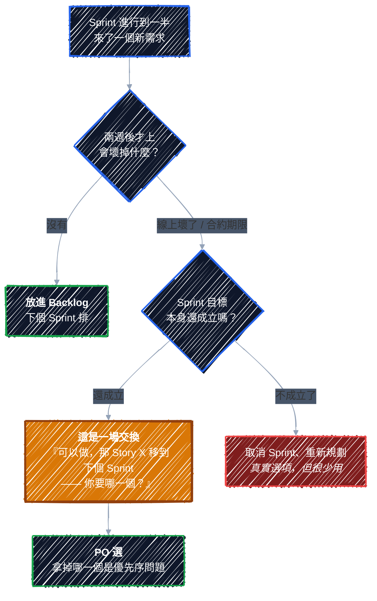

# Q82: What do you do when a requirement changes in the middle of a sprint?

> Tests whether you have actually been in the situation. 'Agile embraces change' is the non-answer; naming what has to come out, and who chooses, is the answer.

**Part:** Process & Collaboration | **Importance:** 6/10 | **Status:** Complete

## In One Sentence

The sprint holds a fixed amount of work, so adding something means taking something else out - and which one comes out is the product owner's call, not the developer's.

一個 Sprint 裝得下的量是固定的，所以要加東西就得拿掉等量的東西 —— 而拿掉哪一個是 PO 決定的，不是工程師決定的。

## Answer Shape

Open with the actual situation rather than a principle, because everyone has been in it and it makes the answer concrete immediately. Sort the request first, since most of them are not urgent. Then give the rule that does the work - capacity is fixed, so this is a trade, not a yes or no. Say who decides what, because handing the decision back to the right person is the whole skill. Finish with what you do when it really is urgent, and what it means if this keeps happening.

從真實的處境開場，而不是從原則，因為每個人都遇過，而且這樣答案立刻變具體。先把請求分類，因為多數根本不緊急。接著給那條真正起作用的規則 —— 容量是固定的，所以這是一場交換，不是一個 yes 或 no。說明誰決定什麼，因為把決定交回給對的人才是真正的本事。最後講真的緊急時怎麼做，以及這件事一直發生代表什麼。

## Full Spoken Answer

Take the real situation. It is day six of a ten-day sprint, and the product manager comes over: a customer has asked for something and it needs to go out this week. Everyone has been here. The unhelpful answer is to quote a principle back - agile embraces change - because that does not tell anyone what actually happens to the work already in flight.

先看真實的處境。十天的 Sprint 走到第六天，PM 走過來：客戶要一個東西，這週一定要上。這個場面每個人都遇過。最沒用的回答是把原則搬出來 —— 「敏捷本來就要擁抱變化」—— 因為那完全沒有回答「已經在做的東西會怎樣」。

The first thing I do is sort the request, because most of them are not what they sound like. Some are genuinely urgent: production is broken, or there is a contractual or regulatory date. Those go in, and everything below is about how. But a lot of them are simply something that occurred to someone this morning, and it will be just as valuable next sprint as it is today. Asking one question usually settles it - what breaks if this ships in two weeks instead of this week? If the honest answer is nothing, it is a backlog item, not an emergency.

我做的第一件事是**把這個請求分類**，因為多數請求都不是它聽起來的那樣。有些是真的緊急：線上壞了，或是有合約、法規的期限。那些就是要進來，後面談的都是「怎麼進」。但很多只是某個人今天早上剛想到的東西，而它下個 Sprint 才做的價值，跟這週做是一樣的。通常問一個問題就分得出來：**如果這件事兩週後才上，會壞掉什麼？** 如果誠實的答案是「沒有」，那它就是一個 backlog 項目，不是一個緊急事件。

If it really does need to go in, the rule that does the work is that the sprint's capacity is fixed. The team committed to a set of stories because that is what fits, so adding something does not create extra hours - it displaces something. That reframes the conversation completely. Instead of saying no, which sounds obstructive, or saying yes, which quietly means the team works late and something slips anyway, you say: yes, we can do this, and to fit it we need to move story X to the next sprint - which would you rather have? It is a trade, and putting it that way is the single most useful thing in this answer.

如果它真的必須進來，那條真正起作用的規則是：**Sprint 的容量是固定的**。團隊當初承諾那些 Story，是因為那剛好裝得下，所以加東西不會變出額外的工時 —— 它會**擠掉**別的東西。這會徹底改變這場對話。你不用說「不行」（聽起來像在擋事），也不用說「好」（那實際上代表團隊加班，而且還是會有東西沒做完），你說的是：**可以做，但要塞進來的話，Story X 得移到下個 Sprint —— 你要哪一個？** 這是一場交換，而把話講成這樣是整個答案裡最有用的一件事。

That works because of who decides what, and being clear about this is what separates someone who has run it from someone who has read about it. The product owner decides priority - what gets built and in what order, and therefore which story comes out. The team decides how it is built and how much fits, because only the team can estimate that. So I am not refusing and I am not deciding; I am giving the trade-off to the person whose job it is to choose, with the cost stated honestly. That is also why it should not be a conversation between one developer and one PM in a corridor - it is a change to what the team committed to, so it is visible to the team and reflected on the board.

這之所以成立，是因為**誰決定什麼**，而把這件事說清楚，正是「跑過」和「讀過」的分水嶺。**PO 決定優先序** —— 做什麼、先做什麼，因此也決定哪個 Story 要被拿出來。**團隊決定怎麼做、以及裝得下多少**，因為只有團隊估得出來。所以我不是在拒絕，也不是在替別人做決定；我是把這個取捨，連同誠實標出的代價，交回給那個職責就是做選擇的人。這也是為什麼它不該是一個工程師和一個 PM 在走廊上的對話 —— 它改變了團隊當初承諾的內容，所以要讓團隊看得到，也要反映在 board 上。

When it genuinely is urgent, there are a couple of practical things worth saying. One is that the sprint can be cancelled and re-planned if the goal itself no longer makes sense - that is a real option in Scrum, just a rare one, and knowing it exists is a good signal. The other is that most teams keep some slack in the sprint precisely for this, usually somewhere around ten to twenty percent, and if the team is also on call then interrupt work should be subtracted from capacity up front rather than treated as a surprise every time.

真的緊急的時候，有兩件實務上值得講。第一，**如果 Sprint 目標本身已經不成立了，Sprint 是可以被取消、重新規劃的** —— 那在 Scrum 裡是一個真實的選項，只是很少用，而知道它存在是個不錯的訊號。第二，多數團隊本來就會在 Sprint 裡留一些餘裕正是為了這種事，通常抓一到兩成；而如果團隊同時要 on-call，那些中斷的工作應該**事先從產能裡扣掉**，而不是每次都當成意外。

The last thing is what it means when this keeps happening, because that is the more interesting answer. One interruption is normal. Every sprint being derailed is a signal, not bad luck. Either the sprint is too long for how fast this business changes, in which case shorten it, or the work genuinely arrives unpredictably - operations, support, incident-driven work - in which case Kanban with a WIP limit fits it better than Scrum does, and forcing it into sprints just produces a plan that is wrong by day three. Noticing that is more valuable than defending the process.

最後一件事是：**這種情況一直發生代表什麼**，因為那才是比較有意思的答案。偶爾被插一次是正常的。每一個 Sprint 都被打亂就是一個訊號，不是運氣不好。要嘛是 Sprint 對這個業務的變動速度來說太長了，那就把它縮短；要嘛是工作真的就是不可預期地進來 —— 維運、支援、事故驅動的工作 —— 那麼**限制 WIP 的 Kanban 比 Scrum 更適合它**，硬塞進 Sprint 只會生出一份第三天就已經錯掉的計畫。看得出這件事，比替流程辯護有價值得多。

## Quick Reference

**The decision, in order:**

**Who decides what - the part that shows you have run it:**

| Decision | Whose call | Why |
|---|---|---|
| What gets built, and in what order | **Product owner** | It is a priority question, and priority is their job |
| Which story comes out to make room | **Product owner** | Same question, asked backwards |
| How it is built | **The team** | They are the ones who know |
| How much fits in the sprint | **The team** | Only they can estimate it |

So you are neither refusing nor deciding - you state the cost honestly and hand the choice back.

**Three ways to answer, and what each one actually costs:**

| Answer | Sounds like | What really happens |
|---|---|---|
| "No, it is not in the sprint" | Obstructive | The request comes back louder, through someone senior |
| "Sure, we will fit it in" | Helpful | The team works late and something slips anyway - quietly |
| "Yes - and X moves to next sprint. Which do you want?" | A trade | The cost is visible, and the right person chooses ✅ |

**When it keeps happening, it is a signal:**

| Pattern | What it means | What to change |
|---|---|---|
| One interruption in a sprint | Normal | Keep 10-20% slack for it |
| The team is on call | Predictable interruption | Subtract that capacity up front |
| *Every* sprint is derailed | Not bad luck | Shorten the sprint, or move to Kanban with a WIP limit |

## Interview Version

> Take the real situation: day six of a ten-day sprint and the PM says a customer needs something this week. I would not answer with a principle like "agile embraces change", because that does not say what happens to the work already in flight. First I sort the request, because most are not what they sound like - some are genuinely urgent, production broken or a contractual date, but many are just something that occurred to someone this morning and would be equally valuable next sprint. One question usually settles it: what breaks if this ships in two weeks instead? If the answer is nothing, it is a backlog item. If it does need to go in, the rule that does the work is that the sprint's capacity is fixed, so adding something displaces something. That reframes it: instead of saying no, which sounds obstructive, or yes, which quietly means the team works late and something slips anyway, I say we can do this, and to fit it story X moves to next sprint - which would you rather have. It is a trade. That works because of who decides what: the product owner decides priority and therefore which story comes out, the team decides how it is built and how much fits. So I am not refusing and not deciding, I am handing the trade-off back with the cost stated honestly - and it goes on the board rather than staying a corridor conversation. If the sprint goal itself no longer makes sense, the sprint can be cancelled and re-planned, which is rare but real. And if every sprint gets derailed, that is a signal rather than bad luck: either the sprint is too long for how fast this business moves, or the work genuinely arrives unpredictably and Kanban with a WIP limit fits it better.

面試時可回答：先看真實的處境：十天的 Sprint 走到第六天，PM 說客戶這週就要一個東西。我不會用「敏捷本來就要擁抱變化」這種原則來回答，因為那沒有說明「已經在做的東西會怎樣」。我會先把這個請求分類，因為多數都不是它聽起來的那樣 —— 有些是真的緊急，線上壞了或有合約期限；但很多只是某個人早上剛想到，下個 Sprint 做價值一樣。通常問一句就分得出來：如果兩週後才上，會壞掉什麼？如果答案是「沒有」，那它就是一個 backlog 項目。如果真的得進來，那條起作用的規則是 Sprint 的容量是固定的，所以加東西就會擠掉別的東西。這會重新框住整件事：我不說「不行」（聽起來像在擋事），也不說「好」（那實際上代表團隊加班，而且還是有東西會延），我說的是「可以做，要塞進來的話 Story X 就移到下個 Sprint —— 你要哪一個？」這是一場交換。這之所以成立是因為誰決定什麼：PO 決定優先序，因此也決定哪個 Story 被拿出來；團隊決定怎麼做、以及裝得下多少。所以我不是在拒絕，也不是在替別人決定，我是把取捨連同誠實的代價交回去 —— 而且它會上 board，不會停留在走廊對話。如果 Sprint 目標本身已經不成立，Sprint 是可以取消、重新規劃的，那很少見但是真的選項。而如果每個 Sprint 都被打亂，那是訊號不是運氣不好：要嘛 Sprint 對這個業務的變動速度來說太長，要嘛工作真的就是不可預期地進來，那麼限制 WIP 的 Kanban 更適合它。

The sentence to remember is: **Sprint capacity is fixed, so a mid-sprint request is not a yes or a no - it is a trade, and which story comes out is the product owner's call, not yours.**

最值得記：**Sprint 的容量是固定的，所以中途插需求不是「答應或拒絕」的問題 —— 它是一場交換，而拿掉哪一個 Story 是 PO 決定的，不是你。**

---

| ⬅ Previous | Home | Next ➡ |
|---|---|---|
| [Q81: How does your team run its development process?](q81-how-your-team-runs-development.md) | [All 52 questions](../../README.md) | *(last question)* |
