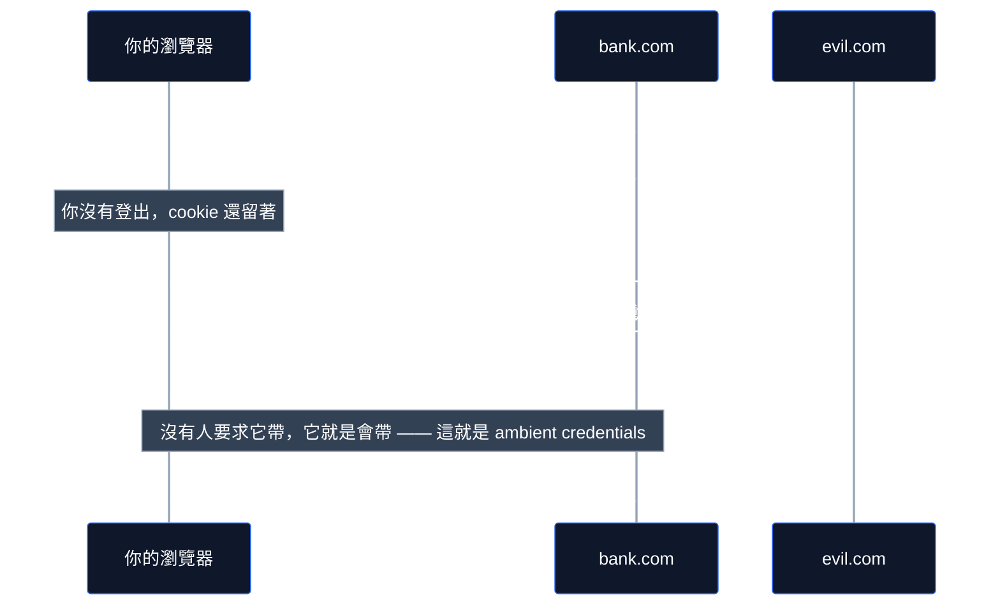

# Q26: What is Cross-Site Request Forgery (CSRF)?

> Tests whether you can explain why the browser sends the cookie at all, and how CSRF differs from XSS.

**Part:** Security & Auth | **Importance:** 7/10 | **Status:** Complete

**New to these terms?** [cookie](../_glossary.md#cookie), [same-origin policy](../_glossary.md#same-origin-policy), [xss](../_glossary.md#xss), [content security policy](../_glossary.md#content-security-policy), [output encoding](../_glossary.md#output-encoding)

## In One Sentence

CSRF is an attacker getting your browser to send a real, fully logged-in request to another site - they never steal your cookie, they just get your browser to use it for them.

CSRF 是攻擊者讓你的瀏覽器對另一個網站送出一個真實、而且已經登入的請求 —— 他偷不走你的 cookie，只是讓你的瀏覽器替他用掉它。

## Answer Shape

Explain the browser behavior that makes the attack possible before describing the attack itself, because the automatic cookie is the whole mechanism. Then walk one concrete scenario end to end with real names - a bank and an attacker's page - because it is far more convincing than the abstract version. Contrast it with XSS in a single line, since the two are almost always asked together and confused. Finish with the defenses and say which one is the modern default.

在描述攻擊本身之前，先解釋讓攻擊得以成立的瀏覽器行為，因為「自動附上的 cookie」就是整個機制。接著用真實的名字完整走過一個具體情境 —— 一家銀行和一個攻擊者的頁面 —— 因為這比抽象版本有說服力得多。再用一句話與 XSS 對照，因為這兩題幾乎總是一起問、也總是被混淆。最後講防禦手段，並說明哪一個是現代的預設。

## Full Spoken Answer

The mechanism starts with a browser behavior, not with a bug in your code. When any page causes a request to go to a domain, the browser attaches the cookies it holds for that domain automatically - it does not care which site initiated the request. That is convenient when the user clicks around your own site, and it is exactly what the attacker uses. The line I would memorize is this: the attacker cannot steal your cookie, but can trick your browser into using it. They never need to know that your cookie reads `session=abc123`. The browser knows, and the browser will send it.

這個機制的起點是一個瀏覽器行為，而不是你程式碼裡的錯誤。當任何頁面觸發一個往某網域的請求時，瀏覽器都會自動附上它為該網域保存的 cookie —— 它不在乎是哪個網站發起的。使用者在你自己網站上點來點去時這很方便，而這也正是攻擊者利用的地方。我會把這句話背起來：攻擊者偷不到你的 cookie，卻能騙你的瀏覽器去用它。他根本不需要知道你的 cookie 寫的是 `session=abc123`。瀏覽器知道，而且瀏覽器一定會送。

So the attack goes like this. You log into `bank.com` and the browser stores `session=abc123`. You do not log out, and later you open `evil.com`, which quietly holds a hidden form or an image tag aimed at a state-changing endpoint on the bank - `POST bank.com/transfer` with `to=hacker` and `amount=10000`. The page submits it for you. The browser attaches your bank cookie because the request is going to the bank, the bank sees a valid authenticated session, concludes that you pressed the button yourself, and moves the money. Notice that the attacker never reads the response - the same-origin policy still stops that - and never needs to. They only need the action to happen. That last point is worth saying out loud, because it is where people misplace their trust: the same-origin policy restricts reading a cross-origin response, it has never stopped a cross-origin request being sent. Sending has always been allowed - that is what a form post, an `` or a `<script src>` to another site is - so CSRF lives exactly in the gap between what the browser blocks and what it still permits.

所以攻擊是這樣進行的。你登入 `bank.com`，瀏覽器存下 `session=abc123`。你沒有登出，之後打開了 `evil.com`，那裡面偷偷放著一個隱藏表單或 image 標籤，指向銀行上會改變狀態的 endpoint —— `POST bank.com/transfer`，帶著 `to=hacker` 和 `amount=10000`。頁面替你把它送出去。因為請求是往銀行去的，瀏覽器就附上了你的銀行 cookie；銀行看到一個有效且已認證的 session，於是認定是你本人按下按鈕，把錢轉走了。請注意：攻擊者從頭到尾沒有讀到回應 —— 同源政策仍然擋著 —— 而他也不需要讀。他只需要那個動作發生。最後這點值得講出來，因為大家常把信任放錯地方：同源政策限制的是「讀取跨來源的回應」，它從來沒有禁止「送出跨來源的請求」。送出一直都是被允許的 —— 表單 POST、``、`<script src>` 指到別的網站，都是這回事 —— 所以 CSRF 正好活在「瀏覽器擋下的」與「瀏覽器仍然放行的」之間那道縫裡。

The server is fooled because it is answering the wrong question. It asks "is this a logged-in user?" and the answer is honestly yes. What the cookie alone can never tell it is whether you pressed Transfer on `bank.com`, or whether `evil.com` made your browser send this. That gap is also the cleanest way to separate CSRF from XSS, which get asked back to back and constantly confused. XSS is the attacker's JavaScript running inside your own site, so they can read everything; CSRF is the attacker's page using your login state from the outside, so they can only cause requests. And note that XSS defeats every CSRF defense, because a script running on your own page can simply read the token.

伺服器之所以被騙，是因為它回答的是錯的問題。它問的是「這是一個已登入的使用者嗎？」，而答案老老實實是「是」。單憑 cookie，它永遠無法判斷的是：這是你在 `bank.com` 上按了轉帳，還是 `evil.com` 讓你的瀏覽器送過來的。這個落差同時也是區分 CSRF 與 XSS 最乾淨的方式，這兩者常被連著問、也一直被混淆。XSS 是攻擊者的 JavaScript 跑進你自己的網站裡執行，所以他什麼都讀得到；CSRF 是攻擊者的頁面從外面借用你的登入狀態，所以他只能促使請求發生。另外要注意：XSS 會擊破所有 CSRF 防禦，因為在你自己頁面上執行的腳本可以直接把 token 讀出來。

For defenses I would name two and say which is the modern default. The classic is a CSRF token: the server puts an unpredictable value such as `x7df92abc` into the page, the client sends it back in a form field or a header, and the server checks it against what it issued. `evil.com` can get the browser to attach the cookie, but it cannot read that token across origins - so its forged request arrives with a valid session and no token, and gets a 403. The double-submit variant puts the same token in both a cookie and a request parameter and compares them, which avoids server-side storage. The modern default, though, is the SameSite cookie attribute - `Set-Cookie: session=abc123; SameSite=Lax; Secure; HttpOnly` - which tells the browser not to attach the cookie to cross-site requests at all, and Lax is already the default in major browsers, blocking the cross-site POST this attack depends on. Checking the Origin or Referer header is a reasonable extra layer. And none of it helps if the endpoint changes state in response to a GET, because an image tag is enough to fire one.

防禦我會講兩個，並說明哪一個是現代的預設。經典做法是 CSRF token：伺服器在頁面中放入一個不可預測的值，例如 `x7df92abc`，客戶端用表單欄位或標頭把它送回來，伺服器再比對是不是自己簽發的那一個。`evil.com` 有辦法讓瀏覽器附上 cookie，卻無法跨來源讀到那個 token —— 所以它偽造的請求會帶著有效的 session、卻沒有 token 抵達，然後拿到 403。雙重提交的變體則把同一個 token 同時放在 cookie 和請求參數中並比對兩者，藉此免去伺服器端儲存。不過現代的預設是 SameSite cookie 屬性 —— `Set-Cookie: session=abc123; SameSite=Lax; Secure; HttpOnly` —— 它告訴瀏覽器根本不要把 cookie 附加到跨站請求上，而目前主流瀏覽器預設的 Lax，已經擋住了這個攻擊所依賴的跨站 POST。檢查 Origin 或 Referer 標頭是合理的額外一層。而如果某個 endpoint 會因為一個 GET 就改變狀態，以上全部都救不了它，因為一個 image 標籤就足以觸發 GET。

## Quick Reference

### The attack, six steps



The attacker is never in the loop after step 3 - and never sees the response. The
same-origin policy stops the reading, not the sending; CSRF lives in that gap.

### The question the server answers, and the one it cannot

| What the server checks | Answer |
|---|---|
| `session=abc123` - is this a logged-in user? | Yes, honestly and correctly |
| Did the user press Transfer on `bank.com`, or did `evil.com` cause this? | The cookie cannot say - that is the whole hole |

### Same cookie, two requests

```http
# Real request, from bank.com's own page
POST /transfer            Cookie: session=abc123
                          X-CSRF-Token: x7df92abc          → 200 OK

# Forged request, from evil.com
POST /transfer            Cookie: session=abc123   ← the browser attached it
                          (no token: evil.com cannot read it)  → 403 Forbidden
```

### CSRF or XSS?

| | CSRF | XSS |
|---|---|---|
| Where the attacker's code runs | On their own page, `evil.com` | Inside your site, in your origin |
| What they exploit | Your login state | Your missing output escaping |
| Can they read the response? | No - they can only cause the request | Yes - everything the page can see |
| Primary fix | SameSite cookies + CSRF token | Output encoding + CSP |

Memory hook: XSS gets the attacker's JavaScript into your site; CSRF gets your browser
to spend your login state for the attacker, from outside. XSS beats every CSRF defense,
because a script on your page can just read the token.

### Defences, in the order to say them

| Layer | What it does | Note |
|---|---|---|
| `SameSite=Lax` cookie | Browser will not attach the cookie to cross-site POSTs | The modern default - already on in major browsers |
| CSRF token | Unpredictable value the attacker cannot read across origins | The classic answer; still name it |
| Double-submit cookie | Same token in a cookie and a parameter, compared | Avoids server-side token storage |
| `Origin` / `Referer` check | Reject requests that did not come from your site | Cheap extra layer |
| No state changes on GET | An `` is enough to fire a GET | Without this, the rest is moot |

The line to remember: CSRF tricks your browser into spending your login state on the attacker's behalf.

## Interview Version

> The mechanism starts with a browser behaviour, not a bug in your code. When any page causes a request to go to a domain, the browser automatically attaches the cookies it holds for that domain - it does not care which site initiated the request. That is convenient when the user navigates your own site, and it is exactly what the attacker uses. So the attack goes like this: the victim is logged into their bank and the session cookie is sitting in the browser. The attacker builds a page containing a hidden form or an image tag whose target is a state-changing endpoint on that bank. The victim visits the attacker's page, which submits the form automatically. The browser sends the request with the victim's session cookie attached, the bank sees a valid authenticated request, and it performs the transfer. Notice that the attacker never reads the response and never steals the cookie - they only need the action to happen. And note where the same-origin policy actually sits: it restricts reading a cross-origin response, it never stopped one being sent, so CSRF lives in that gap. The one-line contrast with XSS is worth memorising because they are asked back to back: CSRF abuses the user's ambient authority, so the attacker cannot read your responses, only cause requests; XSS abuses your output handling, so the attacker gets code running inside your origin and can read everything. And note that XSS defeats every CSRF defence, because a script on your own page can simply read the token. The classic defence is a CSRF token the server issues and checks, which the attacker cannot read across origins. The modern default is the SameSite cookie attribute, which tells the browser not to attach the cookie to cross-site requests at all - Lax, now the default in major browsers, already blocks the cross-site POST this attack depends on. And none of it helps if an endpoint performs a state change in response to a GET.

面試時可回答：這個機制的起點是一個瀏覽器行為，而不是你程式碼裡的錯誤。當任何頁面觸發一個往某網域的請求時，瀏覽器都會自動附上它為該網域保存的 cookie —— 它不在乎是哪個網站發起的。使用者在你自己網站上瀏覽時這很方便，而這也正是攻擊者利用的地方。所以攻擊是這樣進行的：受害者已登入他的銀行，session cookie 就放在瀏覽器裡。攻擊者做一個頁面，裡面有一個隱藏表單或 image 標籤，目標是那家銀行上會改變狀態的 endpoint。受害者造訪攻擊者的頁面，表單自動送出。瀏覽器把請求連同受害者的 session cookie 一起送到銀行，銀行看到的是一個有效且已認證的請求，於是執行了轉帳。請注意：攻擊者從頭到尾沒有讀到回應，也沒有偷到 cookie —— 他只需要那個動作發生。也要注意同源政策實際站的位置：它限制的是讀取跨來源的回應，從來沒有禁止把請求送出去，所以 CSRF 就活在那道縫裡。和 XSS 的一句話對照值得背下來，因為它們常被連著問：CSRF 濫用的是使用者的環境權限，所以攻擊者讀不到你的回應，只能促使請求發生；XSS 濫用的是你的輸出處理，所以攻擊者取得在你來源內執行的程式碼，什麼都讀得到。另外要注意：XSS 會擊破所有 CSRF 防禦，因為在你自己頁面上執行的腳本可以直接把 token 讀出來。經典的防禦是伺服器簽發並檢查的 CSRF token，攻擊者無法跨來源讀取它。現代的預設則是 SameSite cookie 屬性，它告訴瀏覽器根本不要把 cookie 附加到跨站請求上 —— 目前主流瀏覽器預設的 Lax，就已經擋住了這個攻擊所依賴的跨站 POST。而如果某個 endpoint 會因為一個 GET 就改變狀態，以上全部都救不了它。

The sentence to remember is: **CSRF is tricking your browser into sending a request to the bank from someone else's page, using the login you already have - the attacker never steals the cookie and never reads the response, they only need the action to happen.**

最值得記：**CSRF 就是騙你的瀏覽器，用你已經登入銀行的身分，從另一個網站偷偷對銀行送出請求 —— 攻擊者不偷你的 cookie、也讀不到回應，他只需要那個動作真的發生。**

---

| ⬅ Previous | Home | Next ➡ |
|---|---|---|
| [Q24: Describe how session management works in web applications.](q24-session-management.md) | [All 52 questions](../../README.md) | [Q28: What is the difference between HS256 and RS256 for signing a JWT?](q28-jwt-hs256-vs-rs256.md) |
