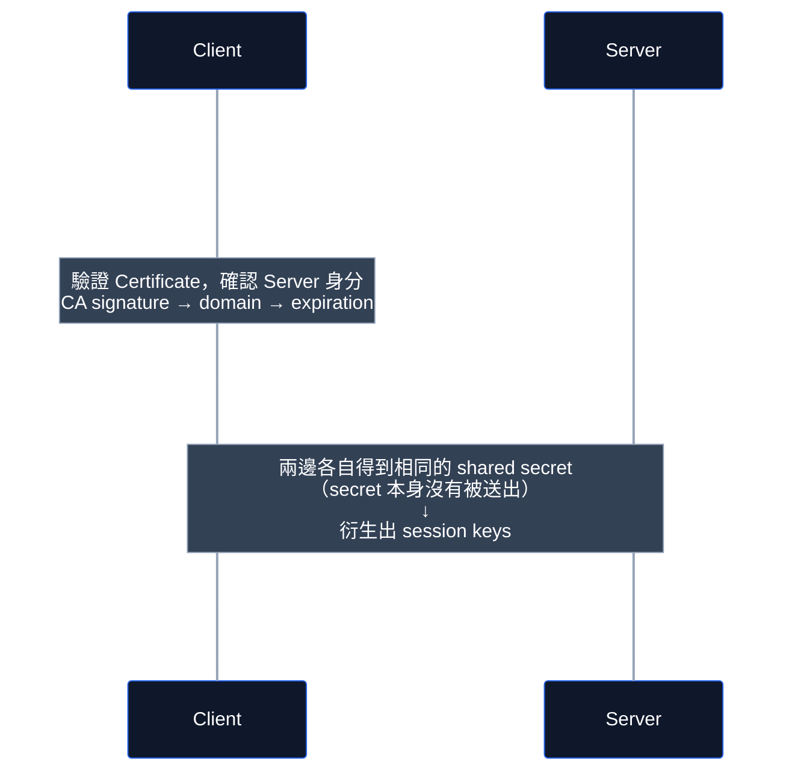

# Q29: How does HTTPS actually encrypt a connection?

> Tests whether you separate authenticating the server from agreeing the key, rather than repeating the pre-TLS 1.3 story where a session key is encrypted with the server public key.

**Part:** Security & Auth | **Importance:** 8/10 | **Status:** Complete

**New to these terms?** [cookie](../_glossary.md#cookie), [session](../_glossary.md#session), [jwt](../_glossary.md#jwt), [load balancer](../_glossary.md#load-balancer)

## In One Sentence

HTTPS is HTTP with a TLS layer wrapped around it: the certificate proves which server you reached, ECDHE lets both sides work out a shared secret that is never sent, and the HTTP data itself travels under fast symmetric encryption.

HTTPS 就是 HTTP 外面加上一層 TLS：憑證證明你連到的是哪一台伺服器，ECDHE 讓雙方各自算出一個從未被送出的 shared secret，而真正的 HTTP 資料則用快速的對稱式加密傳輸。

## Answer Shape

Say what HTTPS is in one line, then what plain HTTP does not do. Name the three things TLS provides, one clause each. Then answer the real question - how it encrypts - by separating the handshake into its two jobs: confirm who the server is, and agree a secret. Keep those two apart, because merging them is what produces the outdated answer. Finish with where TLS actually terminates in a real deployment.

一句話說清楚 HTTPS 是什麼，然後說純 HTTP 少了什麼。把 TLS 提供的三件事點名，每個一句。接著回答真正的問題 —— 它怎麼加密 —— 方法是把 handshake 拆成兩個任務：確認 server 是誰，以及建立一個共同的祕密。這兩件事要分開講，因為把它們混在一起，就會講出那個過時的答案。最後收在真實部署裡 TLS 實際終止在哪裡。

## Full Spoken Answer

HTTPS is just HTTP with a TLS layer wrapped around it. The reason it exists is that HTTP provides no transport encryption of its own, so as a request travels across the network, anything sensitive in it - a password, a session cookie, an account number - can be read by an attacker on the path or by an intermediate device, and can also be modified without either end noticing. TLS is the layer that closes that.

HTTPS 就是 HTTP 外面包一層 TLS。它之所以存在，是因為 HTTP 本身不提供傳輸加密，所以當一個 request 在網路上傳輸時，裡面任何敏感的東西 —— 密碼、session cookie、帳號 —— 都有機會被路徑上的攻擊者或中間設備讀取，而且可以在兩端都沒察覺的情況下被修改。TLS 就是把這個洞補起來的那一層。

TLS provides three things, and it is worth naming all three in one clause each. Encryption means someone in the middle cannot understand the content. Integrity means that if the data is modified, I can detect it. Authentication means I can confirm that the server I am talking to really is the one I meant to reach. People usually say the first and stop, but the third is what gives the other two their value, because encrypting flawlessly to a server that is not the one you wanted buys you nothing.

TLS 提供三件事，而且三件都值得各用一句話點名。**Encryption** 是讓中間的人看不懂內容。**Integrity** 是資料如果被修改，我可以發現。**Authentication** 則是確認我現在連到的，真的是我要找的那一台 server。大家通常講完第一個就停了，但第三個才是讓前兩個有價值的東西，因為對著一台「不是你要找的」伺服器完美加密，什麼也沒買到。

Then the question that actually matters: how does TLS encrypt? Both asymmetric cryptography and symmetric encryption are involved, and the split between them is the whole answer. Symmetric encryption is fast, which makes it the right tool for the real HTTP requests and responses. Its one problem is that the client and the server must already hold the same key, securely - and they have never met. So before any data moves, the handshake has two jobs to finish.

接著是真正重要的問題：TLS 到底怎麼加密？這裡非對稱密碼學和對稱式加密都會用到，而它們之間的分工就是整個答案。**Symmetric Encryption 很快**，所以它才是拿來加密真正的 HTTP request 和 response 的正確工具。它唯一的問題是：client 和 server 必須事先就安全地擁有同一把 key —— 而它們素未謀面。所以在任何資料開始移動之前，handshake 有兩個任務要完成。

The first job is confirming who the server is. The server presents a certificate containing its public key, the domain it is for, and a signature from a certificate authority your client already trusts. The client checks that chain of signatures, checks the domain on the certificate matches the one it asked for, and checks the validity dates. Only once all three pass does the client believe that this public key really belongs to example.com. Note what that key is doing here - it is verifying a signature to establish identity, not encrypting anything for you.

**第一個任務是確認 server 是誰。** Server 會提供一張 Certificate，裡面包含它的 public key、這張憑證對應的 domain，以及一個由你的 client 本來就信任的 CA 所做的簽署。Client 會檢查那條簽章鏈、檢查憑證上的 domain 跟它要求的是否相符、並檢查有效期限。三項全過，client 才相信「這個 public key 確實屬於 example.com」。注意這把金鑰在這裡做的事 —— **它是在驗證簽章、確立身分，不是在幫你加密任何東西。**

The second job is establishing the shared secret that the encryption will actually use. Modern TLS does this with ECDHE: the client and the server exchange public values, and from those each side independently computes the same shared secret - and that secret itself never travels over the network. Session keys are then derived from it. At that point the handshake is essentially done, and everything after it is ordinary HTTP protected by symmetric encryption, which is exactly what you want for bulk data.

**第二個任務是建立後面加密資料真正會用到的 shared secret。** 現代 TLS 用 ECDHE 來做這件事：client 和 server 交換公開資訊，然後各自算出同一個 shared secret —— 而那個 secret 本身從頭到尾沒有在網路上傳送過。接著再從它衍生出 session keys。到這裡 handshake 基本上就完成了，之後就是被對稱式加密保護的普通 HTTP，而那正是大量資料傳輸最適合的方式。

It is worth being precise here, because the commonly repeated version is out of date. People often say TLS encrypts a session key with the server public key and sends it over. That was RSA key transport, and TLS 1.3 removed it entirely, leaving only ephemeral Diffie-Hellman. The reason is forward secrecy: with key transport, anyone who recorded your traffic and later obtained the server private key could decrypt all of it retroactively, whereas an ephemeral exchange leaves nothing to decrypt with. Saying it the accurate way costs no extra words - certificate for identity, ECDHE for the secret.

這裡值得講精確一點，因為最常被複述的版本已經過時了。很多人會說 TLS 用 server 的 public key 把 session key 加密後送過去。**那是 RSA key transport，而 TLS 1.3 已經把它整個移除，只留下 ephemeral Diffie-Hellman。** 原因是 forward secrecy：在 key transport 之下，任何人只要錄下你的流量、之後再取得伺服器的私鑰，就能把過去的通訊全部回溯解密；而 ephemeral 的交換根本沒有留下可以拿來解的東西。用精確的說法並不會多花你幾個字 —— **憑證管身分，ECDHE 管祕密。**

One deployment detail is worth having ready, because it shows up in every Kubernetes or cloud setup. TLS usually terminates at the load balancer or ingress controller rather than at your application, so the path is client to load balancer over HTTPS, then load balancer to backend over HTTP or a separate TLS connection. If it terminates there, your backend receives plain HTTP and learns what the client originally used from `X-Forwarded-Proto`. That is fine inside a network you control, but it does mean that hop is unencrypted unless you arrange otherwise. And the most common TLS incident is not a broken cipher, it is an expired certificate taking the whole site down at once, so renewal should be automated and alerted on well in advance.

有一個部署細節值得先準備好，因為它在每一個 Kubernetes 或雲端環境都會出現。**TLS 通常終止在 Load Balancer 或 Ingress Controller，而不是你的應用程式**，所以路徑是「client 到 load balancer 走 HTTPS，load balancer 到 backend 走 HTTP 或另一條 TLS 連線」。如果 TLS termination 在 load balancer，你的 backend 收到的就是純 HTTP，要靠 `X-Forwarded-Proto` 才知道 client 原本用的是 HTTPS。在你自己控制的網路裡這沒問題，但它確實代表那一段是沒有加密的，除非你另外處理。另外，最常見的 TLS 事故不是加密被破解，而是**憑證過期讓整個網站一次倒掉**，所以續期要自動化，並且提早很久就對到期時間告警。

## Quick Reference

**The mental picture:**



**The three steps, and what each one is for:**

| Step | Mechanism | What it establishes |
|---|---|---|
| **1** | Certificate, signed by a CA | 這台 server 是誰 — the public key really belongs to `example.com` |
| **2** | ECDHE | 一個共同的祕密 — both sides compute it; it is never sent |
| **3** | Session keys derived from that secret | 後面的 HTTP 資料用 symmetric encryption 傳輸 |

> **先驗證你是誰 → 安全建立共同的祕密 → 後面的資料用對稱式加密傳輸。**

**What TLS gives you, and what it does not:**

| Property | In one clause | Without it |
|---|---|---|
| **Encryption** | 別人看不懂內容 | A password or cookie is readable on the path |
| **Integrity** | 資料被修改我會發現 | An intermediate device can alter the response undetected |
| **Authentication** | 我連到的真的是我要找的 server | You may be encrypting flawlessly to the wrong server |
| ~~Who the caller is~~ | Not TLS's job | Still needs a session or token - see [Q21](q21-session-vs-jwt-authentication.md) |

**What the client checks on the certificate:**

```
CA signature  →  domain  →  expiration
```

All three must pass. Skip the check and an intermediate device can present its own certificate, decrypt everything, and re-encrypt to the real server - which is exactly what a corporate proxy does on purpose, by installing its own CA on the machine.

**Why not "encrypt the session key with the server's public key":**

| | RSA key transport (TLS 1.2 and earlier) | ECDHE (TLS 1.3 only allows this) |
|---|---|---|
| **How the key is shared** | Client encrypts it with the server public key and sends it | Both sides compute it; nothing carrying it is sent |
| **Server private key leaks later** | Recorded traffic can be decrypted retroactively | Past sessions stay safe - forward secrecy |
| **Certificate's public key is for** | Encrypting the session key | Verifying a signature, i.e. identity only |

**Where TLS terminates in practice:**


| Thing that actually goes wrong | What to do |
|---|---|
| **Expired certificate** - the most common TLS incident by far, and it takes the site down all at once | Automate renewal, alert well before expiry |
| That hop from the load balancer is plain HTTP | Fine inside a trusted network; terminate again or use mTLS if it is not |
| First request arrives on plain HTTP before the redirect | HSTS, so the browser refuses HTTP for the domain |

## Interview Version

> HTTPS is HTTP with a TLS layer around it. HTTP provides no transport encryption of its own, so a password or session cookie in a request can be read or modified by an attacker on the path or an intermediate device. TLS provides three things: encryption, so the content cannot be understood; integrity, so modification is detectable; and authentication, so I know the server I reached is the one I meant. The interesting part is how it encrypts, and that is a split between asymmetric cryptography and symmetric encryption. Symmetric is fast, so it is what carries the actual HTTP requests and responses, but it needs both sides to already hold the same key securely - and they have never met. So the handshake has two jobs. First, confirm who the server is: it presents a certificate with its public key, its domain, and a CA signature, and the client checks the signature chain, the domain match, and the expiry before believing that key belongs to example.com. Second, establish the shared secret, which modern TLS does with ECDHE - both sides exchange public values and independently compute the same secret, which is never sent over the network, and session keys are derived from it. After that it is ordinary HTTP under symmetric encryption. I would be careful not to say TLS encrypts a session key with the server's public key, because that is RSA key transport and TLS 1.3 removed it - the reason being forward secrecy, since recorded traffic plus a later private key leak would otherwise decrypt everything retroactively. In a Kubernetes or cloud setup TLS usually terminates at the load balancer or ingress, so the backend receives plain HTTP and reads `X-Forwarded-Proto` to know what the client used.

面試時可回答：HTTPS 就是 HTTP 外面加上一層 TLS。HTTP 本身不提供傳輸加密，所以 request 裡的密碼或 session cookie，有機會被路徑上的攻擊者或中間設備讀取或修改。TLS 提供三件事：Encryption，讓別人看不懂內容；Integrity，資料被修改我可以發現；Authentication，讓我確認連到的真的是我要找的 server。有趣的部分是它怎麼加密，而那是非對稱密碼學和對稱式加密之間的分工。Symmetric 很快，所以它負責承載真正的 HTTP request 和 response，但它需要雙方事先就安全地擁有同一把 key —— 而它們素未謀面。所以 handshake 有兩個任務。第一，確認 server 是誰：它提供一張 Certificate，裡面有 public key、domain 和 CA 的簽署，client 會檢查簽章鏈、domain 是否相符、以及有效期限，全過了才相信那把 key 屬於 example.com。第二，建立 shared secret，現代 TLS 用 ECDHE 做 —— 雙方交換公開資訊，各自算出同一個 secret，而它從未在網路上傳送，接著再從它衍生出 session keys。之後就是被對稱式加密保護的普通 HTTP。我會避免說「TLS 用 server 的 public key 把 session key 加密送過去」，因為那是 RSA key transport，TLS 1.3 已經移除它了 —— 原因是 forward secrecy：否則只要錄下流量、之後再拿到私鑰，過去的通訊就能全部回溯解密。在 Kubernetes 或雲端環境，TLS 通常終止在 load balancer 或 ingress，所以 backend 收到的是純 HTTP，要靠 `X-Forwarded-Proto` 知道 client 原本用的是什麼。

The sentence to remember is: **The certificate proves who the server is, ECDHE establishes a shared secret that is never sent, and the HTTP data itself travels under symmetric encryption.**

最值得記：**Certificate 驗證身分，ECDHE 建立 shared secret，最後用 symmetric encryption 傳 HTTP 資料。**

---

| ⬅ Previous | Home | Next ➡ |
|---|---|---|
| [Q27: What is CORS?](q27-cors.md) | [All 48 questions](../../README.md) | [Q33: Explain the underlying data structures of lists, sets, tuples, and dictionaries in Python.](../architecture-and-scaling/q33-python-builtin-data-structures.md) |
