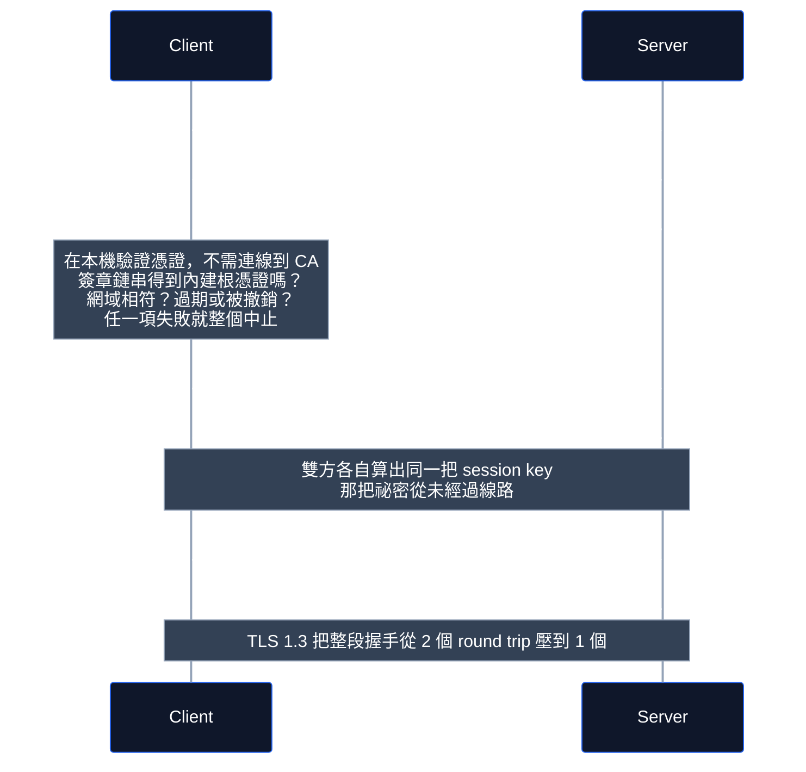

# Q29: How does HTTPS actually encrypt a connection?

> Tests whether you can say why two kinds of encryption are needed rather than one, and whether you know the certificate is what stops you encrypting to an attacker.

**Part:** Security & Auth | **Importance:** 8/10 | **Status:** Complete

**New to these terms?** [cookie](../_glossary.md#cookie), [session](../_glossary.md#session), [jwt](../_glossary.md#jwt), [load balancer](../_glossary.md#load-balancer)

## In One Sentence

HTTPS uses slow asymmetric encryption once, purely to agree on a shared key with a server it has never met, then uses that fast shared key to encrypt everything else - and the certificate is what proves the server you agreed it with is really the one you meant.

HTTPS 先用一次慢的非對稱加密，純粹為了跟一台素未謀面的伺服器**談出一把共用金鑰**，之後所有資料都用那把快的共用金鑰加密；而憑證的作用，是證明跟你談的那台伺服器真的是你要找的那一台。

## Answer Shape

Start from what plain HTTP leaks, because the three things TLS provides only make sense against what is missing without it. Then answer the real question - why two kinds of encryption instead of one - since that is what the interviewer is listening for. Walk the handshake in order. Finish on the certificate, because encryption without identity is encryption to whoever intercepted you.

從「純 HTTP 會外洩什麼」開始，因為 TLS 提供的三件事，要對照「沒有它會缺什麼」才講得通。接著回答真正的問題 —— 為什麼需要兩種加密而不是一種 —— 因為那才是面試官在聽的。然後按順序走一遍握手。最後收在憑證，因為沒有身分的加密，等於加密給攔截你的人看。

## Full Spoken Answer

Start with what plain HTTP actually leaks, because that is what makes the rest concrete. You are on cafe wifi and you log in over HTTP. Your password goes out as readable text, and so does the session cookie that comes back. Anyone else on that network can read both, and so can every router between you and the server, and your ISP. Worse than reading, they can change it - rewrite the response, inject a script, swap a bank account number - and neither side can tell. TLS is what turns that open line into a private one.

先講純 HTTP 到底會外洩什麼，因為那會讓後面的東西變具體。你在咖啡廳的 wifi 上用 HTTP 登入。你的密碼是以可讀的文字送出去的，回傳的 session cookie 也是。同一個網路上的任何人都讀得到這兩樣，而你和伺服器之間的每一台路由器、還有你的 ISP，也都讀得到。比讀取更糟的是他們可以**改**它 —— 重寫回應、注入一段 script、換掉一個銀行帳號 —— 而且兩邊都察覺不到。TLS 就是把那條公開的線變成私密的東西。

TLS gives you three things, and it is worth naming all three because most people only say the first. Encryption means nobody in the middle can read it. Integrity means nobody can modify it without being detected, because every record carries an authentication tag that fails if a single byte changes. Authentication means you know which server you are talking to. That third one is the one people forget, and it is the one that makes the other two worth anything - encrypting perfectly to an attacker who intercepted you is no better than plain text.

TLS 給你三樣東西，而三樣都要點名，因為多數人只會講第一樣。**加密**代表中間的人讀不到。**完整性**代表沒有人能在不被發現的情況下改動它，因為每一筆記錄都帶著一個驗證標記，只要改動一個位元組就會驗不過。**身分驗證**代表你知道自己在跟哪一台伺服器說話。第三樣是最常被忘記的，而它正是讓前兩樣有價值的東西 —— 完美地加密給一個攔截你的攻擊者看，並不會比明文好到哪裡去。

The question underneath this one is why there are two kinds of encryption instead of one, and that is what the interviewer is really listening for. Symmetric encryption uses a single shared key for both directions and is fast enough to carry a whole connection. Its problem is that both sides must already hold that same key - and you have never met this server, so how do you agree on a secret over a wire that everybody can read? Asymmetric encryption solves exactly that: a key pair where what the public key locks only the private key opens, so a secret can be sent to someone you have never met. Its problem is that it is orders of magnitude slower. So TLS uses each for what it is good at - asymmetric once, only to agree on a key, then symmetric for every byte after that.

這題底下真正的問題是「為什麼是兩種加密而不是一種」，而那才是面試官真正在聽的。**對稱加密**兩個方向用同一把共用金鑰，快到足以承載整條連線。它的問題是雙方必須**事先就握有同一把鑰匙** —— 但你從沒見過這台伺服器，那要怎麼在一條所有人都看得到的線上談出一個祕密？**非對稱加密**解決的正是這件事：一組金鑰對，公鑰鎖起來的東西只有私鑰打得開，所以你可以把祕密送給一個素未謀面的人。它的問題是慢上好幾個數量級。所以 TLS 讓兩者各做各擅長的事 —— **非對稱只用一次，純粹為了談出一把金鑰；之後每一個位元組都走對稱。**

The handshake in order is short enough to say out loud. The client sends a hello listing the TLS versions and cipher suites it supports, plus a random number. The server replies with the ones it picked, its own random number, and its certificate, which contains its public key and the domain it is for. The client verifies that certificate, and only then does the key exchange happen - in modern TLS that is ECDHE, where each side sends a public value and both independently compute the same shared secret, which is never transmitted at all. Combined with the two random numbers, that becomes the session key. Both sides switch to symmetric encryption and the HTTP request finally goes out. TLS 1.3 matters here because it cut the handshake from two round trips to one, which is a real latency win on a mobile connection.

握手的順序短到可以直接講出來。客戶端送出一個 hello，列出它支援的 TLS 版本和加密套件，外加一個隨機數。伺服器回覆它選定的版本與套件、它自己的隨機數，以及它的**憑證** —— 憑證裡有它的公鑰和這張憑證對應的網域。客戶端先驗證那張憑證，驗過了才進行金鑰交換 —— 現代 TLS 用的是 ECDHE，雙方各自送出一個公開值，然後各自算出同一個共用祕密，而那個祕密**從頭到尾沒有在線路上傳輸過**。再結合那兩個隨機數，就得到 session key。雙方切換到對稱加密，這時候 HTTP 請求才真正送出去。TLS 1.3 在這裡很重要，因為它把握手從兩個往返縮成一個，在行動網路上是實實在在的延遲改善。

Then the certificate, which is the part that answers "but how do I know that public key is really the bank's". Anyone can generate a key pair and claim to be bank.com, so a certificate is that public key plus the domain name, signed by a certificate authority - an organisation your browser and operating system were shipped already trusting. Your client checks the signature chains up to one of those roots, that the domain on the certificate matches the one you typed, and that it has not expired or been revoked. Skip that check and a machine in the middle simply hands you its own key, decrypts everything, re-encrypts it to the real server, and reads the lot - which is exactly what a corporate proxy does deliberately.

接著是憑證，它回答的是「那我怎麼知道那把公鑰真的是銀行的？」。任何人都能產生一組金鑰對並宣稱自己是 bank.com，所以**憑證就是「那把公鑰加上網域名稱，再由一個憑證頒發機構（CA）簽名」** —— CA 是那種你的瀏覽器和作業系統出廠時就已經信任的機構。你的客戶端會檢查簽章能不能一路串到那些內建的根憑證、憑證上的網域是不是你輸入的那個、以及它有沒有過期或被撤銷。跳過這個檢查，中間的一台機器就可以直接遞給你它自己的金鑰，把你的東西解密、再用真正伺服器的金鑰重新加密送過去，然後全程都讀得到 —— 而那正是企業代理伺服器刻意在做的事。

Two practical points are worth having ready because they come up in real systems. The first is that TLS almost always terminates at the load balancer rather than at your application, so the application speaks plain HTTP and reads the original scheme from `X-Forwarded-Proto`. That is fine, but it means the hop from the load balancer to your service is unencrypted unless you arrange otherwise, which matters once that hop crosses a network you do not control. The second is that the most common TLS incident is not a broken cipher, it is an expired certificate taking the whole site down at once - so automate renewal with something like Let's Encrypt and alert on expiry well ahead of time. Add HSTS while you are there, since it tells the browser to refuse plain HTTP for your domain and closes the downgrade window on the very first request.

有兩個實務重點值得先準備好，因為它們在真實系統裡一定會遇到。第一，**TLS 幾乎都是終止在 load balancer 而不是你的應用程式**，所以應用程式講的是純 HTTP，靠 `X-Forwarded-Proto` 讀出原本的協定。這沒問題，但它代表從 load balancer 到你的服務那一段是沒有加密的，除非你另外處理 —— 而一旦那一段跨越了你控制不了的網路，這件事就有影響。第二，**最常見的 TLS 事故不是加密演算法被破解，而是憑證過期，整個網站一次全倒** —— 所以要用 Let's Encrypt 這類工具自動續期，並且提早很多就對到期時間告警。順手把 HSTS 也加上，它會告訴瀏覽器對你的網域拒絕純 HTTP，把降級攻擊的空窗關在第一個請求之前。

## Quick Reference

**Why two kinds of encryption:**

| | Symmetric | Asymmetric |
|---|---|---|
| **Keys** | One shared key, both directions | A key pair - public locks, private opens |
| **Speed** | Fast enough for the whole connection | Orders of magnitude slower |
| **The problem it has** | Both sides must already hold the key | Too slow to carry traffic |
| **The problem it solves** | Bulk data | Agreeing a secret with a stranger |
| **Used in TLS for** | Every byte after the handshake | The handshake only |

**The handshake:**

Asymmetric work happens once, in the middle. Everything above it is negotiation and everything below it is symmetric.

**What TLS gives you, and what it does not:**

| Property | What it means | Without it |
|---|---|---|
| **Encryption** | Nobody in the middle can read it | Your password and session cookie are plain text on the wire |
| **Integrity** | Nobody can modify it undetected | A router can inject a script or swap an account number |
| **Authentication** | You know which server you reached | You may be perfectly encrypting to the attacker |
| ~~Who the caller is~~ | Not TLS's job | Still needs a session or a token - see [Q21](q21-session-vs-jwt-authentication.md) |

**The certificate, in one line:** a public key plus a domain name, signed by a CA your browser already trusts - so it answers "is this public key really bank.com's?", which encryption alone cannot.

**Things that actually go wrong:**

| | What happens | What to do |
|---|---|---|
| **Expired certificate** | The whole site goes down at once - the most common TLS incident by far | Automate renewal (Let's Encrypt), alert well before expiry |
| **TLS terminated at the load balancer** | The hop to your service is plain HTTP; the app reads `X-Forwarded-Proto` | Fine inside a trusted network; encrypt that hop if it is not |
| **First request on plain HTTP** | A downgrade window before the redirect | HSTS, so the browser refuses HTTP for the domain |
| **Certificate check disabled "to make it work"** | Any machine in the middle can read everything | Never in production - this is what a corporate proxy exploits by design |

## Interview Version

> Over plain HTTP your password and session cookie travel as readable text, so anyone on the same wifi, every router in between, and your ISP can read them - and can modify the response without either side noticing. TLS gives three things: encryption so nobody in the middle can read it, integrity so nobody can change it undetected, and authentication so you know which server you reached. People forget the third, but it is what makes the other two worth anything, because encrypting perfectly to an attacker who intercepted you is no better than plain text. The real question is why there are two kinds of encryption. Symmetric uses one shared key and is fast enough for a whole connection, but both sides must already hold that key - and you have never met this server, so you cannot agree a secret over a wire everyone can read. Asymmetric solves exactly that, since what the public key locks only the private key opens, but it is orders of magnitude slower. So TLS uses asymmetric once, purely to agree a key, then symmetric for every byte after. The handshake is: client hello with supported ciphers and a random number, server hello with its choice and its certificate, the client verifies that certificate, then a key exchange - modern TLS uses ECDHE, where both sides compute the same secret without it ever crossing the wire - and both switch to symmetric. TLS 1.3 cut that from two round trips to one. The certificate answers "how do I know that public key is really the bank's": it is the public key plus the domain, signed by a CA the browser already trusts, and the client checks the chain, the domain match, and the expiry. Skip that and a machine in the middle hands you its own key and reads everything. In practice TLS usually terminates at the load balancer, so the app speaks HTTP and reads `X-Forwarded-Proto` - and the most common incident is not a broken cipher but an expired certificate taking the site down.

面試時可回答：在純 HTTP 上，你的密碼和 session cookie 是以可讀的文字傳輸的，所以同一個 wifi 上的任何人、中間每一台路由器、還有你的 ISP 都讀得到 —— 而且可以在兩邊都沒察覺的情況下改掉回應。TLS 給三樣東西：加密，讓中間的人讀不到；完整性，讓別人改了會被發現；身分驗證，讓你知道自己連到的是哪一台伺服器。大家都會忘記第三樣，但它才是讓前兩樣有價值的東西，因為完美地加密給一個攔截你的攻擊者看，並不比明文好。真正的問題是「為什麼要兩種加密」。對稱加密用一把共用金鑰，快到可以承載整條連線，但雙方必須事先就握有那把鑰匙 —— 而你從沒見過這台伺服器，沒辦法在一條大家都看得到的線上談出祕密。非對稱加密解決的正是這件事，因為公鑰鎖起來的只有私鑰打得開，但它慢上好幾個數量級。所以 TLS 用非對稱一次，純粹為了談出一把金鑰，之後每一個位元組都走對稱。握手是：客戶端 hello 帶著支援的加密套件和一個隨機數，伺服器 hello 回覆它的選擇和它的憑證，客戶端驗證那張憑證，接著做金鑰交換 —— 現代 TLS 用 ECDHE，雙方算出同一個祕密而它從未經過線路 —— 然後兩邊切換到對稱加密。TLS 1.3 把這段從兩個往返縮成一個。憑證回答的是「我怎麼知道那把公鑰真的是銀行的」：它是公鑰加上網域，由一個瀏覽器本來就信任的 CA 簽名，而客戶端會檢查簽章鏈、網域是否相符、以及有沒有過期。跳過這步，中間的機器就直接遞它自己的金鑰給你，然後全部讀光。實務上 TLS 通常終止在 load balancer，所以應用程式講的是 HTTP，靠 `X-Forwarded-Proto` 判斷原本的協定 —— 而最常見的事故不是加密被破解，是憑證過期讓整個網站倒掉。

The sentence to remember is: **Asymmetric encryption is used once to agree a shared key, symmetric carries everything after it - and the certificate is what proves the key you agreed belongs to the site you meant, without which you are just encrypting neatly to an attacker.**

最值得記：**非對稱加密只用一次，為了談出一把共用金鑰；之後全部由對稱加密承載 —— 而憑證證明的是「你談定的那把金鑰真的屬於你要找的網站」，沒有它，你只是很工整地加密給攻擊者看。**

---

| ⬅ Previous | Home | Next ➡ |
|---|---|---|
| [Q27: What is CORS?](q27-cors.md) | [All 48 questions](../../README.md) | [Q33: Explain the underlying data structures of lists, sets, tuples, and dictionaries in Python.](../architecture-and-scaling/q33-python-builtin-data-structures.md) |
